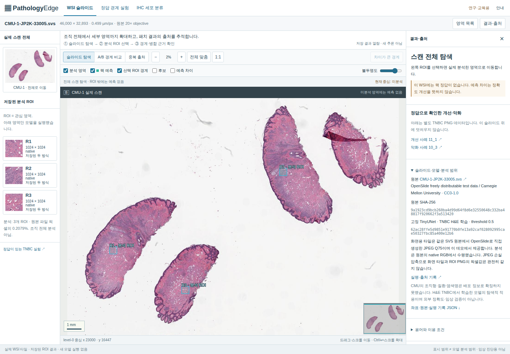
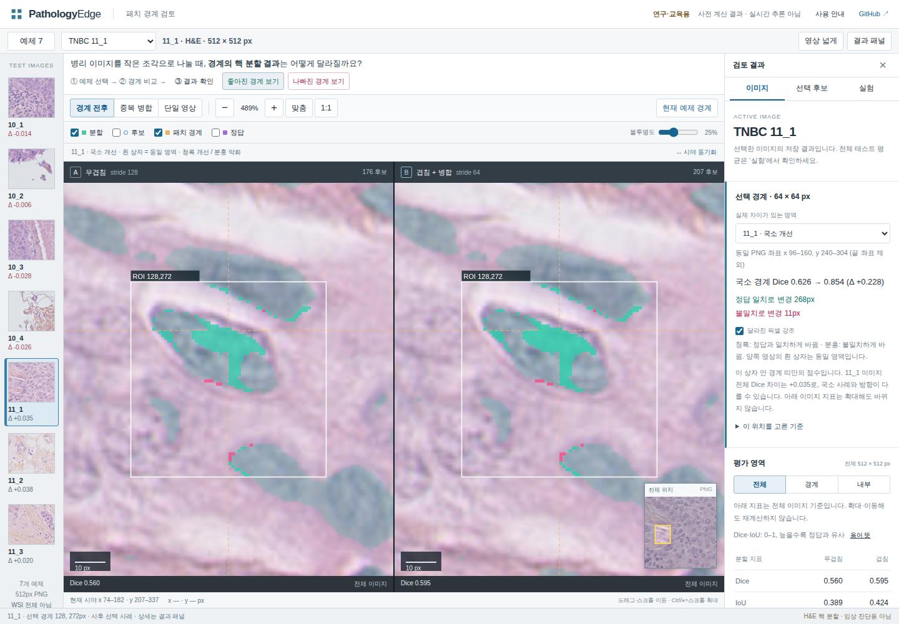
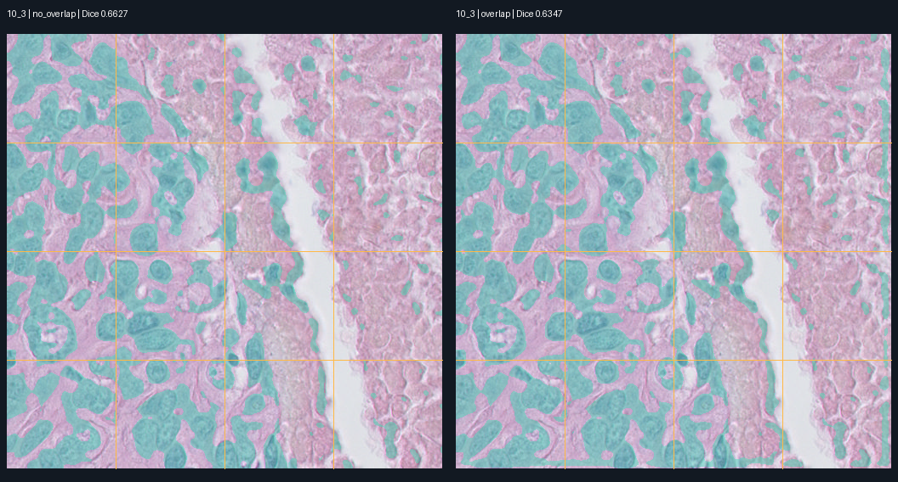

# Pathology Edge

**병리 이미지의 패치 경계가 핵 분할에 미치는 영향을 재현하고 검토하는 연구용 작업대.**
같은 모델의 무겹침·겹침 처리를 비교하고, 정확도·처리 시간·메모리·실패 사례를 함께 공개합니다.

[실제 WSI 탐색](https://pathology-edge-lab.ykh13571.chatgpt.site/wsi.html) · [정답 경계 실험](https://pathology-edge-lab.ykh13571.chatgpt.site/) · [IHC 분류](https://pathology-edge-lab.ykh13571.chatgpt.site/ihc.html) · [지금 할 27단계 WSI 분석 범위](docs/STEP_27.md) · [실행 안내](docs/RUNBOOK.md) · [기여 기록](docs/CONTRIBUTIONS.md)

연구·교육용입니다. 에이비스와 무관한 독립 프로젝트이며 실제 진단·치료 결정에 사용할 수 없습니다.
**WSI 탐색, 제한된 ROI의 예측 비교, 별도 IHC의 정답 중심점 조건 분류를 구분합니다. 자동 Ki-67 검사·WSI 전체 모델 처리·임상 검증은 수행하지 않았습니다.**

## 실제 WSI와 IHC 확장

| 화면 | 실제 데이터·실행 범위 | 확인할 수 있는 것 | 평가 범위 |
|---|---|---|---|
| WSI 탐색 | CC0 CMU-1 JP2K SVS,46,000×32,893,0.499µm/px | 전체 스캔→native 상세 타일→3개 분석 ROI→동기화 경계 비교→후보와 원 패치 추적 | 고정 모델을3×1024²에 실행. 원본 파일 면적의0.2079%, GT 없음. 예측 차이를 정확도라고 부르지 않음 |
| 정답 경계 실험 | 기존 TNBC test7장/2그룹 | 좋아진·나빠진 경계, 정답과 오류 픽셀, 비용 | 기존 결과를 그대로 유지 |
| IHC 분류 | Patherea P1 Ki67,29case/1,330patch/19,972점,CC BY-NC4 | 실제 염색·GT 중심·정답/오답·네 클래스 점수 | train/val/test15/4/10case, 정답 중심점 조건의4종 세포 분류. 자동 검출 아님 |

WSI의 확대 영상은 OpenSeadragon6.1.1이 OpenSlide4.0.1로 원본 SVS에서 생성한 전체 다중 해상도 타일을 요청합니다. 공식 외부 타일은 로컬에서 열렸지만 배포 도메인의 요청을403으로 거부해, 확보한 CC0 원본에서 타일을 생성하여 데모와 함께 제공합니다. 실제 원본 SHA를 확인하고 OpenSlide4.0.1로 읽은 native ROI에 기존 TinyUNet을 실행했습니다. 같은 좌표의 예측·XOR 차이·원 패치와 NMS 사유가 연결됩니다. JPEG Q75와 분석 입력인 원본 RGB는 손실압축 때문에 픽셀값이 완전히 같지 않으며 좌표 정렬을 별도로 검사합니다.

세 WSI ROI에서 warm CPU 중앙값은 무겹침 **0.297–0.329초**, 겹침 **1.249–1.899초**, 독립 worker peak RSS **446–474MiB**였습니다. 전체 WSI 처리 비용이 아닙니다. [실험·좌표·선택 규칙](docs/WSI_EXPERIMENT.md).

별도 IHC 실험은 RGB/HSV/OD 특징과 LogisticRegression으로 주어진 세포 중심의 종양+/종양−/기타+/기타−를 분류했습니다. 고정 test10case·6,419세포에서 **macro-F1 0.600906**, accuracy0.703692였습니다. 양성 비종양 F1은 **0.205650**으로 낮았습니다. 검출 오류와 전체 슬라이드 Ki67 지수는 평가하지 않았습니다. 저자 fold1 test를 고정하고 train에서만 validation을 나눠 C를 선택했습니다. [실행 결과·한계](docs/IHC_EXPERIMENT.md).

Hann 겹침·경계 평가·WSI linked view·provenance 자체는 선행 기능입니다. 이 프로젝트의 설명 가능한 강점은 **같은 작은 CPU 모델의 실제 결과를 원본 좌표→패치→후보→억제 사유→오류·비용으로 추적하는 좁고 재현 가능한 검토 흐름**입니다. [16개 프로젝트·논문 비교](docs/WSI_LANDSCAPE.md), [WSI·도구·권리 비교](docs/WSI_DATA_OPTIONS.md), [AIVIS 업무와 IHC 자료](docs/AIVIS_IHC_FEASIBILITY.md)를 설계 전에 조사했습니다. 타사 모델 성능은 직접 재현한 값이 아닙니다.

## 영상 작업대

새 WSI·IHC 화면의 조사, 실제 실험, 검증·배포 및 직접 확인 순서는 [확장 보고서](docs/WSI_REVIEW.md)에 정리했습니다. 아래 새 화면에서 실제 WSI를 탐색할 수 있습니다.



[변경 전](artifacts/ui/wsi/before-desktop.png) · [WSI 경계 비교](artifacts/ui/wsi/wsi-boundary.png) · [후보 출처](artifacts/ui/wsi/wsi-candidate-provenance.png) · [IHC 분류](artifacts/ui/wsi/ihc-desktop.png)

기존 TNBC 정답 경계 화면도 유지했습니다.

QuPath·Aperio·에이비스의 공개 화면을 조사해 영상 중심의 검토 화면으로 구성했습니다.
썸네일 선택 → 같은 위치 확대 → 경계 비교 → 억제/유지 후보 추적을 한 화면에서 수행합니다.
‘좋아진 경계 보기’는 `11_1`, ‘나빠진 경계 보기’는 `10_3`의 실제 오류 변화로 이동합니다.
‘현재 예제 경계’로 `10_1`의 악화도 확인할 수 있습니다. 정답과 대조한 11개 국소 사례는 사후 설명용이며 평균 성능의 대표값이 아닙니다.
큰 화면은 동기화 A/B, 작은 화면은 같은 시야의 A/B 전환입니다. 사전 계산된 실제 결과를 표시하며 새 추론을 실행하지 않습니다.



[이번 변경 전](artifacts/ui/interview/before-desktop.png) · [악화 경계](artifacts/ui/interview/after-worsened.png) · [실험 비교](artifacts/ui/interview/after-experiment.png) ·
[모바일](artifacts/ui/interview/after-390.png) · [사례 선택·수치 대조·직접 확인 순서](docs/INTERVIEW_UI.md) · [조사 출처와 변경 이유](docs/UI_REVIEW.md) · [UI 검증·재현 명령](docs/UI_VERIFICATION.md) · [확대 후 이동 오류 수정](docs/PAN_FIX.md)

## 실제 결과

TNBC v1.1의 50개 512×512 이미지·이진 핵 마스크를 사용했습니다.
폴더 그룹 단위로 train 33 / validation 10 / test 7장을 분리했습니다.
공식 설명은 11환자이나 독립 환자 명부가 없어 `Slide_01..11`을 케이스 그룹으로 사용한 한계가 있습니다.
선택된 모델은 test를 보지 않고 validation으로 epoch 12·threshold 0.5를 결정했습니다.

| 방식 | 전체 Dice | 경계 Dice | 내부 Dice | 시간/장 ms | 전체 프로세스 peak MiB |
|---|---:|---:|---:|---:|---:|
| OpenCV 기준 | 0.4867 | 0.4658 | 0.4916 | 3.7 | 412.9 |
| TinyUNet 무겹침 | 0.5580 | 0.4918 | 0.5729 | 57.2 | 430.5 |
| TinyUNet 겹침 + 병합 | 0.5608 | 0.5273 | 0.5696 | 309.3 | 437.3 |
| TinyUNet 512px 전체 (참고) | 0.5655 | 0.5313 | 0.5744 | 88.5 | 487.3 |

경계는 기준 128px 격자의 내부 경계 양쪽 8px이며 모든 방식에 같은 영역을 적용했습니다.
Dice는 이미지별 점수의 평균입니다. 시간은 모델 로딩·디스크 I/O·지표 계산을 제외한
패치 추출→조직 게이트→추론→확률 합산→성분 추출→NMS의 warm CPU 3회 중앙값을 이미지 간 다시 중앙값으로 집계했습니다.
메모리는 방식별 별도 프로세스의 절대 peak RSS이며 런타임·warmup·평가를 포함합니다. 추가 메모리만을 뜻하지 않습니다.

겹침은 경계 Dice를 약 **+0.0355**, 전체 Dice를 **+0.0028** 높였지만 시간은 약 **5.4배** 걸렸습니다.
그룹10 전체 Dice는 0.5187→0.5003으로 하락했고 그룹11은 0.6104→0.6415로 상승했습니다.
두 그룹·한 seed의 결과이므로 일반적인 해결이나 유의한 개선을 주장하지 않습니다.
512px 전체 입력과의 경계 확률 차이는 MAE 0.0560→0.0068로 감소했습니다. 이는 일관성 지표이며 정답 정확도를 대신하지 않습니다.



위는 개선이 가장 적은 `10_3`입니다. 전체 Dice가 0.6627→0.6347로 하락합니다.
[GT·FP·FN 비교](artifacts/error_10_3.png), [낮은 점수 사례](artifacts/error_10_4.png),
[개선 사례](artifacts/error_11_2.png)를 함께 보세요. 이미지는 실제 결과 시각화이며 브라우저 화면 캡처가 아닙니다.

## 핵심 구현

```text
공식 ZIP + checksum → 원본/GT 쌍 검사 → 케이스 그룹 분리
  → OpenCV 조직 마스크 / Python·C++ 패치 추출
  → TinyUNet 추론 (각 패치의 원래 PNG 좌표 보존)
  ├─ 확률맵 가중 합산 → 이진 분할 → Dice·IoU / 경계·내부 평가
  └─ 패치별 연결 성분 → 원래 PNG 좌표 → cross-patch NMS → 후보 검토
  → 고정 결과 JSON·overlay → 동기화 웹 작업대
```

각 패치는 좌표·유효 영역·level·downsample을 갖습니다. 이번 PNG에는 실제 WSI 원점·배율·MPP가 없으므로
물리 해상도는 null이고 좌표 단위는 `provided_png_pixels`입니다. 일반 배율·리사이즈 변환 함수는 사용자 작성·검토를 마쳤으며, 실제 파이프라인의 일반 배율 어댑터 연결은 후속 작업입니다.

무겹침은 128px/stride128, 겹침은 128px/stride64이며 trailing patch를 흰색으로 padding합니다.
512px 입력은 각각 16·64개 패치입니다. 픽셀은 Hann 계열 중앙 가중치로 합칩니다.
성분은 경계에 닿지 않은 후보 우선으로 정렬하고, 다른 patch 사이 IoU≥0.3 또는 중심 거리≤8px이면 억제합니다.
NMS는 근접한 다른 핵을 합치거나 잘린 조각을 놓칠 수 있는 휴리스틱입니다.

이진 GT의 연결 성분 중심으로 계산한 proxy F1은 겹침 raw 0.2671→NMS 0.4943이지만,
**진짜 세포별 instance label·종양 세포 정확도·Ki-67 지표가 아닙니다.**
픽셀 합산과 성분 NMS는 별도 경로이므로 녹색 영역의 연결 성분 수와 선택 가능한 후보 수가 다를 수 있습니다.

## C++ / 스레드 측정

`cpp/patches.cpp`는 실제 RGB crop·흰색 padding을 수행합니다. GIL을 해제하고 독립 패치를
std::thread로 분담합니다. Python 배열 복사 구현과 동일한 출력을 검증했습니다.

| 입력 | 구현 | 스레드 | 중앙값 ms | 전체 프로세스 peak MiB | Python 대비 |
|---|---|---:|---:|---:|---|
| 512² | python | 1 | 0.248 | 42.0 | 일치 |
| 512² | cpp | 1 | 0.123 | 42.1 | 일치 |
| 512² | cpp | 2 | 0.162 | 42.0 | 일치 |
| 512² | cpp | 4 | 0.208 | 41.9 | 일치 |
| 2048² | python | 1 | 11.967 | 188.9 | 일치 |
| 2048² | cpp | 1 | 8.400 | 189.6 | 일치 |
| 2048² | cpp | 2 | 6.761 | 188.5 | 일치 |
| 2048² | cpp | 4 | 5.299 | 188.9 | 일치 |

합성 uint8 RGB, 패치128/겹침64, warmup 후 9회, allocation·복사·padding 포함.
의학적 성능 실험이 아닙니다. peak 메모리는 정합성 검사의 두 출력 배열까지 포함하므로 연산만의 추가 메모리로 해석하지 않습니다.
작은 입력에서 4 thread는 C++ 1 thread보다 느립니다. 입력이 커지면 이번 환경에서는 다중 스레드가 빨랐습니다.
실제 test 7장의 무겹침·겹침 **14개 확률맵도 Python/C++ 경로가 bit-for-bit 일치**했습니다.
원시값: [benchmark.json](artifacts/benchmark.json), [cpp_real_parity.json](artifacts/cpp_real_parity.json).

## 업무·기술 대응

지정된 사람인 공고 원문은 열리지 않았습니다. 사용자 요약에 더해 에이비스의 공개 제품 자료와 [병역일터의 별도 공식 채용공고](https://work.mma.go.kr/caisBYIS/search/cygonggogeomsaekView.do?byjjeopche_cd=&cygonggo_no=2000001538893&menu_id=m_m7_1)를 확인했습니다. 동일한 채용공고라고 단정하지 않습니다. [근거와 업무 연결](docs/AIVIS_IHC_FEASIBILITY.md)을 참고하세요.

| 기술/업무 | 코드와 실제 실행 |
|---|---|
| Python / 실험·재현성 | `data.py`, `experiment.py`, `cli.py`, manifest·protocol·hash |
| PyTorch / 설계·학습·추론 | `model.py` TinyUNet, 29,761 parameters, 16 epochs 실행·checkpoint 저장 |
| Computer Vision / 병리 이미지 | 핵 분할, 경계·내부 평가, 확률 합산, 연결 성분·오류 overlay |
| OpenCV | RGB/HSV/gray 전처리, 배경 제외, threshold 기준 방식, 연결 성분 |
| C++ | `cpp/patches.cpp`, Python/C++ 실제 추출·추론 출력 정합성 |
| 멀티스레딩 | C++ 1·2·4 thread 실행, 두 크기에서 시간·메모리 비교 |
| Ubuntu | Ubuntu 24.04 Docker 안의 테스트·실제 이미지 추론 |
| Docker | Ubuntu 기반 Dockerfile 실제 빌드·실행, CA proxy 대응은 secret 사용 |
| Git / GitHub / CI | 실행 코드·실험 파일·테스트 게시, `.github/workflows/ci.yml` |
| classification / detection / segmentation | TNBC segmentation 평가, WSI ROI 탐색적 추론, 별도 IHC GT-center 4class 분류. detection은 기존 CC centroid proxy이며 자동 IHC 검출 평가 없음 |

회사 제품은 종양 세포 기반 Ki-67 정량화를 다룹니다. 이 프로젝트는 그 전제인 세포 수준 영상 처리와
재현·오류 추적 역량을 보여줍니다. 제품과 같은 성능·임상 범위를 갖는다고 설명하지 않습니다.

## 실행과 검증 상태

- 학습: Debian 13, AMD EPYC 9V74, 노출 CPU 5개, Torch thread4, GPU 없음. 약 **42.6초**.
- 일반 테스트: 9단계 사용자 그룹 검사 검토 후 Codex 호스트에서 **107 passed, 0 skipped**. 완료한 사용자 테스트도 기본 CI에 포함됩니다. 배포 버전7 당시 Ubuntu Actions는 **56 passed / 사용자12 skipped**였습니다. 기존 Ubuntu 24.04 Docker 실행은 **33 passed**이며 이번에 Docker를 다시 실행하지 않았습니다.
- 사용자가 그룹 누수 보고 함수와 **18 passed in 0.04s**를 제출했습니다. Codex도 독립18개 통과와 실제50개 목록의 그룹 누수 없음·메모리 복사본의 합성 누수 검출을 확인했습니다. [검토 기록](artifacts/learning/step09-review.json). 준비 당시89통과/18skip은 과거 기록입니다. 사용자도 실제 목록50개·11그룹의 `group_leaks: {}` 출력을 제출했습니다. [사용자 실행 보고 검토](artifacts/learning/step10-review.json).
- 사용자가 Dice 함수와 **20 passed in 0.01s**를 제출했습니다. Codex 독립20개 통과와 실제 TNBC 점수42개·평균6개의 원 실험/화면 일치를 확인했습니다. [검토 기록](artifacts/learning/step04-review.json), [검산 기록](artifacts/learning/step04-real-dice-audit.json). 준비 당시69통과/20skip은 과거 기록입니다. 사용자도 로컬 빈 함수 오류 복구 안내 후 검산을 재실행해42/42·6/6 일치 출력을 제출했습니다. [사용자 실행 보고 검토](artifacts/learning/step05-review.json).
- 사용자가 NMS 반례 테스트 본문과 **1 passed in 0.01s**를 제출했습니다. 독립 실행에서도1개 통과했고 기본 전체 검사에 편입했습니다. [검토 기록](artifacts/learning/step02-review.json). 준비 당시68통과/1skip은 과거 기록입니다.
- 사용자가 좌표 함수와 **12 passed in 0.31s**를 제출했습니다. Codex도 같은12개를 통과했고, 이제 기본 전체 테스트에 포함됩니다. [검토·실행 구분](artifacts/learning/step01-review.json).
- 실제 모델 추론·학습·평가·C++ 정합성·정적 UI 파일과 실제 결과 연결 검사 완료.
- 공개 데모는 [Sites](https://pathology-edge-lab.ykh13571.chatgpt.site)에 배포했습니다.
- 공개 버전7에서 Chromium·WebKit 각각 실제 조작 **46 tests**, 기존 화면 좌표 **5 tests** 통과. 데스크톱·태블릿·모바일 크기와 로딩/오류/빈 상태·지연 복구를 확인했습니다. [확장 근거](docs/WSI_REVIEW.md). 과거 공개 버전5의 각26개 검사 기록은 [기존 보고서](docs/INTERVIEW_UI.md)에 유지했습니다.
- 사용자가 WSI R1 이동·경계 차이·후보 출처를 확인했고 드래그·스크롤 요청에 이동 정상 보고를 보냈습니다([U07·U33·U34·U36·U37](docs/CONTRIBUTIONS.md)). 개별 입력 로그·다른 ROI/배율·브라우저 버전은 별도 미확인입니다. 좌표 함수의12개 테스트 통과는 사용자 보고로 확인했으며, 상세 실행 환경 로그는 받지 않았습니다.
- GitHub Actions: [CPU 검사 이력](https://github.com/sokldjs554/pathology-edge/actions/workflows/ci.yml), [checkout UI 검사](https://github.com/sokldjs554/pathology-edge/actions/runs/42462829668), [공개 URL UI 검사](https://github.com/sokldjs554/pathology-edge/actions/runs/42463547474) 성공. UI 소스 `b5024b0` 기준이며 후속 문서·증거 추가는 UI 파일을 바꾸지 않습니다. 공개2,188개 파일의 저장소 정합성은 `artifacts/ui/wsi/production-files.json`에 있습니다.

[](https://github.com/sokldjs554/pathology-edge/actions/workflows/ci.yml)

```bash
# 저장소 루트, 개발 환경 설치 후: 제공 모델의 실제 추론
python -m pathology_edge.cli infer --image dist/assets/10_1.png --backend cpp --threads 4
# 저장소 루트: 일반 테스트 (검토 완료한 사용자 좌표 함수 포함)
python -m pytest -q
# 저장소 루트: 사전 계산 결과를 로컬 웹에서 검토
python -m http.server 8000 --directory dist --bind 127.0.0.1
```

상세한 환경·데이터·학습·평가·Docker 명령은 [RUNBOOK](docs/RUNBOOK.md)에 있습니다.
무료 CPU만 사용했으며 유료 API, 외부 사전학습 모델, 의료 영상 업로드 기능은 사용하지 않았습니다.

## 사용자와 Codex의 역할

사용자가 `src/pathology_edge/learner_coordinates.py`의 `local_to_level0` 구현과12개 테스트 통과 결과를 제출했습니다.
Codex는 제출한 알고리즘을 바꾸지 않고 검토·독립 실행했습니다. 축별 역변환 설명까지 확인해 [1단계](docs/STEP_01.md)를 완료했습니다. [2단계](docs/STEP_02.md)의 반례 해석·테스트 작성·실행 보고, [3단계](docs/STEP_03.md)의 과대 집계 설명, [4단계](docs/STEP_04.md)의 Dice 구현·20개 테스트 통과 보고도 확인했습니다.
[5단계](docs/STEP_05.md)에서 사용자도 본인이 작성한 Dice로 실제 저장 결과를 재계산하고42개 점수·6개 평균 일치 출력을 제출했습니다. 데이터를 읽는 검산 스크립트는 Codex가 작성했습니다. [6단계](docs/STEP_06.md)의 영역별 평균, [7단계](docs/STEP_07.md)의 평균·개별 이미지, [8단계](docs/STEP_08.md)의 일반화 한계, [9단계](docs/STEP_09.md)의 그룹 함수·18개 테스트, [10단계](docs/STEP_10.md)의 그룹 검사, [11단계](docs/STEP_11.md)의 파일 중복 구분, [12단계](docs/STEP_12.md)의 저장 해시, [13단계](docs/STEP_13.md)의 국소 점수·같은 위치, [14단계](docs/STEP_14.md)의 드래그와 [15단계](docs/STEP_15.md)의 스크롤 정상 보고도 확인했습니다. [16단계](docs/STEP_16.md)의 강조 표시 끄기·켜기도 탭·버튼 위치 안내 후 사용자 확인을 받았습니다. [17단계](docs/STEP_17.md)의11_1 전환·양쪽 같은 위치·국소 Dice0.626→0.854도 사용자 확인을 받았습니다. [18단계](docs/STEP_18.md)의 변경 픽셀 수와 핵 개수 구분 설명도 확인했습니다. [19단계](docs/STEP_19.md)의 시간 집계·측정 범위 설명도 확인했습니다. [20단계](docs/STEP_20.md)의11_2 첫 병합 쌍 이동·#74 억제→#54 유지 표시도 사용자 확인을 받았습니다. [21단계](docs/STEP_21.md)의 NMS 대응과 실제 핵 정답 구분 설명도 확인했습니다. [22단계](docs/STEP_22.md)의 WSI R1 이동·양쪽 같은 조직 위치도 사용자 확인을 받았습니다. [23단계](docs/STEP_23.md)의 같은 경계 위치·추가347px/제거123px 표시도 사용자 확인을 받았습니다. [24단계](docs/STEP_24.md)의 정답 없는 WSI 예측 변화 해석도 안내 후 확인했습니다. [25단계](docs/STEP_25.md)의 WSI 후보 쌍·원 패치 ID 표시도 사용자 확인을 받았습니다. [26단계](docs/STEP_26.md)의 WSI 이동 조작 요청에도 통합 정상 보고를 받았습니다. 현재는 [27단계](docs/STEP_27.md)에서 전체 탐색과 실제 분석·검증 범위를 구분합니다.

그 결과에 의존하지 않는 모델·기반 코드·데모·검증은 Codex가 수행했습니다.
[기여 기록](docs/CONTRIBUTIONS.md)은 코드 작성 / 테스트·화면 확인 / 검토·결정 / Codex 작업을
구분합니다. 사용자가 실제로 수행한 근거를 받기 전에는 사용자 항목을 완료로 바꾸지 않습니다.
[후속 작업 목록](docs/NEXT_STEPS.md)은 현재 활성 단계와 아직 배정하지 않은 후보를 구분합니다.

## 남은 한계

WSI 전체 모델 처리, 자동 IHC 검출·분할·Ki67 임상 지수, ViT/사전학습 비교, 다중 seed·신뢰구간,
외부 정확도 검증·병리 전문가·임상 검증은 미수행입니다. CMU WSI에는 핵 정답이 없고, IHC는 단일 기관·제공 중심점 조건입니다. 전체 WSI JPEG 타일을 포함해 저장소 용량이 증가했습니다. 사용자 좌표 함수는 구현·검토됐으며 실제 파이프라인의 일반 배율 어댑터 연결은 별도 후속 작업입니다.
단순 핵 foreground만으로 임상 세포 수를 정할 수 없고, 두 테스트 그룹의 성능 차이가 큽니다.
현재 test를 보며 모델을 다시 선택하면 새 평가 설계가 필요합니다.

데이터·모델·의존성 출처와 조건은 [THIRD_PARTY.md](THIRD_PARTY.md)에 있습니다.
TNBC 예제의 CC BY 4.0을 유지하며, 자체 코드의 일괄 오픈소스 라이선스는 사용자 결정 전이라 선언하지 않았습니다.
