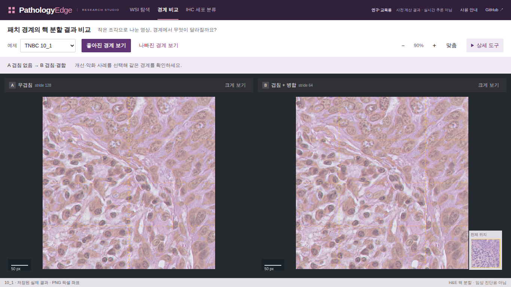

# PathologyEdge

**병리 이미지를 작은 패치로 나눌 때 경계에서 핵 분할 결과가 어떻게 달라지는지 비교하는 연구용 작업대입니다.** 원본 위치에서 예측·오류 픽셀·중복 후보·처리 비용을 함께 확인합니다.

[데모 열기](https://pathology-edge-lab.ykh13571.chatgpt.site/) · [대표 결과](#results) · [빠른 시작](#quick-start) · [실행 안내](docs/RUNBOOK.md) · [직접 수행 기록](docs/CONTRIBUTIONS.md)

| 구분 | 확인할 수 있는 범위 | 코드·상태 |
|---|---|---|
| 공개 작업대 | TNBC 경계 비교, 실제 WSI 탐색·3개 ROI 예측, 정답 중심 조건 IHC 분류 | 저장 결과: [`main`](https://github.com/sokldjs554/pathology-edge/tree/main) · 배포 UI: [`feat/linked-pathology-workbench`](https://github.com/sokldjs554/pathology-edge/tree/feat/linked-pathology-workbench), main 미병합 |
| 후속 연구 | 자동 IHC 패치 검출·분류, 사전학습 대조, 추가 외부 평가 | [`feat/auto-ki67`](https://github.com/sokldjs554/pathology-edge/tree/feat/auto-ki67) · [Draft PR #2](https://github.com/sokldjs554/pathology-edge/pull/2), main 미병합·공개 데모 미적용 |

연구·교육용 독립 프로젝트입니다. 공개 웹 화면은 **사전 계산된 실제 결과**를 표시합니다. 실제 모델 추론은 아래 CLI로 실행하며, 임상 진단·치료용 도구가 아닙니다.

## 화면에서 확인하기

1. **[경계 비교](https://pathology-edge-lab.ykh13571.chatgpt.site/)**: ‘좋아진 경계 보기’ 또는 ‘나빠진 경계 보기’ → 같은 위치의 A/B 영상과 선택 영역의 변화 수치를 확인합니다. **근거 보기**에서 상세 결과를, **상세 도구**에서 원본·정답 4분할·후보 표·중복 병합·표시 설정·전체 실험을 엽니다. 후보 표의 행을 선택하면 해당 위치와 실제 확대 조각이 연결됩니다.
2. **[WSI 탐색](https://pathology-edge-lab.ykh13571.chatgpt.site/wsi.html)**: 전체 슬라이드 확대 → R1–R3 선택 → 해당 ROI의 예측 차이 확인. 전체 슬라이드 탐색과 일부 ROI의 분석을 구분합니다.
3. **[IHC 세포 분류](https://pathology-edge-lab.ykh13571.chatgpt.site/ihc.html)**: 예제와 세포 선택 → 정답·예측 클래스 비교. 이 공개 화면은 정답 중심 좌표가 주어진 분류 실험입니다.



[원본·정답 포함 4분할](artifacts/ui-stain-theme/readability-four.png) · [영상과 후보 데이터 연결](artifacts/ui-stain-theme/studio-data-laptop.png)

[WSI 전체 탐색 화면](artifacts/ui-stain-theme/wsi-overview.png) · [악화 사례](artifacts/ui-stain-theme/simple-worsened.png) · [UI 조사·설계](docs/UI_REVIEW.md) · [화면 개편·전후 비교](docs/UI_LINKED_WORKBENCH.md) · [H&E 색상 체계](docs/UI_COLOR_SYSTEM.md)

## 직접 담당한 범위

**직접 작성한 부분은 아래 7개 핵심 항목입니다.** 모델 backbone·학습 실행기·C++ 추출기·뷰어 등 제공된 구현을 활용해 실험했습니다. 직접 작성 범위는 아래 표에, 제공된 인터페이스·테스트·실행기 범위는 기여 기록에 정리했습니다.

| 코드 | 직접 작성한 내용 |
|---|---|
| [`local_to_level0`](src/pathology_edge/learner_coordinates.py) | 입력 검사와 모델 좌표 → 원본 좌표 변환 |
| [NMS 반례 테스트](tests/learner/test_merge_counterexample.py) | 서로 다른 핵이 하나로 억제되는 합성 사례의 검증 본문 |
| [`dice_score`](src/pathology_edge/learner_metrics.py) | 이진 입력 검사, 평가 영역 선택, Dice 계산 |
| [`find_group_leaks`](src/pathology_edge/learner_split.py) | train/validation/test 사이의 그룹 중복 검사 |
| [`soft_dice_loss`](src/pathology_edge/learner_losses.py) | sigmoid, 이미지별 soft Dice, 배치 평균 계산 본문 |
| [`roi_points_to_level0`](src/pathology_edge/learner_wsi.py) | 실제 ROI 읽기 크기·모델 크기와 좌표 변환 연결 |
| [`LocalResidualHead`](src/pathology_edge/learner_refinement.py) | 합성곱 1→8→1, ReLU, 마지막 층 0 초기화, 잔차 합산 |

- **실행:** 작성 코드의 테스트, 저장 Dice 42개·평균 6개 대조, 데이터 분리 검사, Codespaces 비교 학습·세 seed 반복, C++ 추출 8조건·72회 측정, Ubuntu 고정 소스 재현.
- **검토:** 개선·악화 사례, FP/FN과 양성률 분모, 후보 억제의 한계, WSI·IHC 분석 범위, 처리 시간·seed 변동 해석.
- **Git:** 재현 로그 9개 commit·push, [PR #1](https://github.com/sokldjs554/pathology-edge/pull/1) 생성·병합. Docker는 원격 CI 결과 화면을 확인한 범위입니다.

세부 작성 범위·받은 도움·실행 근거는 [기여 기록](docs/CONTRIBUTIONS.md)에, 후속 연구까지의 확인 범위는 [U00–U106 고정 기록](https://github.com/sokldjs554/pathology-edge/blob/095b0196585c05b256942bfe6bf889c3668a136c/docs/CONTRIBUTIONS.md)에 있습니다. 후속 자동 구현·학습·검산을 본인의 직접 실행으로 합산하지 않습니다.

<a id="results"></a>
## 대표 결과

Dice는 높을수록 정답 영역과 잘 겹칩니다. 표의 Dice는 원본 수치를 소수점 넷째 자리로 반올림했습니다. 아래 실험은 **서로 다른 모델·분할·실행**이므로 행 사이의 점수를 같은 실험처럼 비교하지 않습니다.

| 실험·수행 범위 | 데이터·조건 | 결과와 비용·한계 |
|---|---|---|
| 공개 TNBC 무겹침 → 겹침 | test 7장·2그룹, 같은 TinyUNet·한 seed | 전체 Dice **0.5580→0.5608**, 경계 **0.4918→0.5273**, 내부 **0.5729→0.5696**. CPU **57.2→309.3ms/장** |
| 본인 BCE → BCE+soft Dice | validation 10장, 세 paired seed·6회 학습 | 선택 Dice 평균 **0.5182→0.5462**, 세 seed 모두 상승. 모델 선택에 사용한 검증 점수이며 독립 test 개선 증명이 아님 |
| 본인 CNN → 소형 ViT | validation 10장, 한 seed | 전체 Dice **0.5038→0.5576**, 7장 상승·3장 하락. 사전학습 없는 작은 분할 모델 비교 |
| 본인 ViT → 잔차 보정 | validation 10장, 한 seed, 153개 파라미터 추가 | 전체 Dice **0.5706→0.5904**, 경계 **0.5588→0.5590**. CPU 파이프라인 **43.672→55.680ms** |
| 후속 외부 분할 평가 | 고정한 보정 전후 모델, MoNuSeg 14 ROI / NuCLS 51시야 | Dice **0.5520→0.5349**(13장 악화) / **0.6281→0.6130**(43시야 악화). 내부 개선이 외부에서 유지되지 않음 |
| 본인 C++ 구간 측정 | 2048² 입력, Python 1thread → C++ 4threads | 추출 중앙값 **22.418→11.453ms**, 최대 **1.96배**. 전체 모델 추론 속도가 아니며 작은 입력에서는 스레드 증가가 불리 |

공개 TNBC의 경계는 128px 격자 내부 경계 양쪽 8px이며, Dice는 이미지별 점수의 평균입니다. 시간은 CPU 예열 후 이미지별 3회 중앙값의 7장 중앙값으로, 추출·조직 검사·추론·확률 결합·후처리를 포함하고 모델 로딩·디스크 I/O·정답 평가는 제외합니다. 별도 worker의 런타임·모델·예열·평가를 포함한 절대 peak RSS는 무겹침 **430.5MiB**, 겹침 **437.3MiB**였습니다. 전체·경계 평균 상승과 개별 이미지·내부 영역 악화를 함께 보존했습니다.

공개 TNBC 시간은 AMD EPYC 9V74·노출 CPU 5개·PyTorch 4threads에서 측정했습니다. 본인 C++ 측정은 AMD EPYC 7763·사용 가능 CPU/affinity 2개 환경이며 다른 실험의 시간과 직접 비교하지 않습니다.

[공개 실험 원본](artifacts/evaluation.json) · [본인 손실 비교](artifacts/learning/step42-user-summary.json) · [C++·CNN/ViT 원본 감사](docs/USER_RESEARCH_AUDIT.md) · [보정 실험](docs/USER_REFINEMENT_AUDIT.md) · [MoNuSeg](docs/EXTERNAL_MONUSEG_VALIDATION.md) · [NuCLS](docs/NUCLS_GRID_ALIGNMENT.md)

## 처리 흐름과 기술 선택

```text
원영상 + 정답 → 이미지/라벨 검사 → 케이스 그룹 분리
  → 좌표·유효 영역을 보존한 패치 추출 → PyTorch 모델 추론
  ├─ 확률맵 가중 합산 → 이진 분할 → 전체·경계·내부 Dice / IoU
  └─ 패치별 연결 성분 → 원본 좌표 → 중복 후보 억제 → 후보 출처 검토
  → 저장 JSON·오버레이 → 같은 시야로 움직이는 A/B 작업대
```

- **Python·NumPy:** 좌표 변환·입력 계약·평가 계산을 분리해 원본 위치와 수치를 추적합니다.
- **PyTorch:** CPU에서 재현할 수 있는 작은 기준 모델로 패치 처리·손실·모델 구성요소의 차이를 비교합니다.
- **OpenCV·C++/pybind11:** 조직 검사·연결 성분과 crop/padding을 처리합니다. C++은 Python 출력과 대조하고 추출 구간만 별도 측정합니다.
- **OpenSlide·OpenSeadragon:** 원본 WSI 좌표와 다중 해상도 탐색을 연결합니다. 정적 뷰어는 결과 검토를 담당합니다.

무겹침은 128px/stride 128, 겹침은 128px/stride 64입니다. stride는 다음 패치로 이동하는 간격입니다. 픽셀 확률은 Hann 계열 가중치로 합칩니다. 후보 NMS는 다른 패치의 IoU≥0.3 **또는** 중심 거리≤8px 등을 이용하는 별도 경로입니다. 후보 수를 정답 핵 개수로 해석하지 않으며, 근접한 서로 다른 핵을 억제하는 반례도 검사합니다.

<a id="quick-start"></a>
## 빠른 시작

**화면만 보려면** 위 공개 데모를 여세요. 로컬 화면에는 Git과 Python 3만 필요합니다. 아래 명령은 상위 작업 폴더에서 시작합니다.

```bash
git clone --depth 1 --filter=blob:none --sparse --branch feat/linked-pathology-workbench https://github.com/sokldjs554/pathology-edge.git pathology-edge
cd pathology-edge
git sparse-checkout set dist
python3 -m http.server 8000 --directory dist --bind 127.0.0.1
```

`http://127.0.0.1:8000`에서 예제 7개와 경계 비교 화면이 보이면 정상입니다. WSI는 `/wsi.html`, IHC는 `/ihc.html`입니다. 서버 종료는 `Ctrl-C`입니다. 이 경로는 화면용 파일만 받아 저장 결과를 표시하며 PyTorch 설치·학습을 시작하지 않습니다.

| 하고 싶은 작업 | 환경·예상 결과 | 안내 |
|---|---|---|
| 저장 점수 검산 | 개발 환경에서 Dice 42/42·평균 6/6 일치 확인, 추론 없음 | [환경·검산](docs/RUNBOOK.md#development) |
| 실제 모델 추론 | 제공된 `10_1` 이미지 → 새 mask·확률맵·결과 JSON | [한 장 추론](docs/RUNBOOK.md#inference) |
| 데이터·학습·평가 재현 | Ubuntu/Codespaces CPU, 새 실험 폴더에 학습·test 결과 저장 | [전체 재현](docs/RUNBOOK.md#reproduction) |
| 테스트·Docker 실행 | 현재 checkout의 검사·컨테이너 실행 | [테스트](docs/RUNBOOK.md#tests) · [Docker](docs/RUNBOOK.md#docker) |

전체 개발 환경은 Ubuntu 24.04·Python 3.12 CPU를 기준으로 검증했습니다. 위 경량 checkout을 모델 실행용으로 확장하는 방법과 macOS 11의 적용 범위는 RUNBOOK에 있습니다.

## 공개 버전과 후속 연구

**공개 TNBC 모델·본인 소형 ViT 비교는 외부 사전학습 가중치를 사용하지 않았습니다.** 별도 연구에서는 **ImageNet SqueezeNet1.1의 고정 특징**과 같은 구조의 무작위 고정 특징을 세 seed로 비교했습니다. 따라서 ‘프로젝트 전체에서 사전학습을 사용하지 않았다’고 표현하지 않습니다.

[마지막 고정 연구 보고서](https://github.com/sokldjs554/pathology-edge/blob/095b0196585c05b256942bfe6bf889c3668a136c/docs/KI67_FINAL_TRANSFER.md)의 기준 충족 수는 내부 채택 **0/3**, 재사용 내부 test 407장 **1/3**, 재사용 BCData 133장 **3/3**, 새 DeepLIIF 597장 **1/3**입니다. 이는 기존 검출기 A 대비 새 사전학습 검출기 B의 결과이며, 무작위 특징 대조는 사전학습 효과를 분리하는 별도 비교입니다. 모든 seed에서 안정적인 종합 개선은 달성하지 못했고 공개 모델은 교체하지 않았습니다.

[전체 진행·개인 수행 자료 ZIP](https://raw.githubusercontent.com/sokldjs554/pathology-edge/b15ae2ae0bcc2934da2df30d544bae993cdae86d/artifacts/handoff/PathologyEdge-All-Progress-U106-20261115.zip)에는 문서·소스·대표 화면·본인 원본 실험 ZIP과 대용량 근거의 고정 링크가 있습니다(약97.9MB). 후속 코드는 [Draft PR #2](https://github.com/sokldjs554/pathology-edge/pull/2)에 있으며 연구 HTML은 공개 작업대와 별도입니다.

[](https://github.com/sokldjs554/pathology-edge/actions/workflows/ci.yml?query=branch%3Amain)
[](https://github.com/sokldjs554/pathology-edge/actions/workflows/ci.yml?query=branch%3Afeat%2Fauto-ki67)

CI는 각 버전의 Python 테스트·저장 Dice 대조·JavaScript 문법·정적 데모 연결을 검사합니다. 브라우저 조작 검증과 과거 테스트 수는 [검증 이력](docs/PROJECT_HISTORY.md#verification)에 별도로 보존합니다.

## 한계·출처·상세 문서

- 공개 경계 비교는 TNBC test 7장·2케이스 그룹·한 seed입니다. validation에서 선택한 손실/모델 점수를 독립 test 성능으로 바꾸지 않습니다.
- CMU WSI는 전체 탐색과 3×1024² ROI 예측만 제공합니다. 분석 면적은 원본 파일의 약0.2079%이고 핵 정답은 없습니다. **전체 WSI 핵 정답 기반 평가·임상 검증은 미실시**입니다.
- 공개 IHC는 정답 중심 조건 분류입니다. 후속 자동 분석과 DeepLIIF의 전체 세포 양음성 과제도 임상 종양 Ki-67 지수 검증을 대신하지 않습니다.
- 반복 사용한 외부 자료의 개선은 재평가로 보고합니다. 환자·기관 독립성과 일반화는 자료별 근거 범위를 따릅니다.

| 목적 | 문서 |
|---|---|
| 설치·추론·재현·문제 해결 | [RUNBOOK](docs/RUNBOOK.md) |
| 개인 작성·실행·검토 근거 | [CONTRIBUTIONS](docs/CONTRIBUTIONS.md) |
| 연구 흐름·과거 테스트·원문 보관 | [PROJECT_HISTORY](docs/PROJECT_HISTORY.md) |
| WSI·IHC의 입력·분석 범위 | [WSI 실험](docs/WSI_EXPERIMENT.md) · [IHC 실험](docs/IHC_EXPERIMENT.md) |
| 공고·업무와의 연결 | [직무 대조](docs/JOB_MATCH_2026-11-10.md) |
| 데이터·모델·코드의 권리 | [THIRD_PARTY](THIRD_PARTY.md) |

TNBC는 CC BY 4.0, CMU 공개 WSI는 CC0, Patherea 데이터는 CC BY-NC 4.0입니다. 그 외 데이터와 사전학습 가중치는 각 연구 보고서의 출처·조건을 유지합니다. 자체 코드에 일괄 오픈소스 라이선스를 선언한 상태는 아닙니다.
