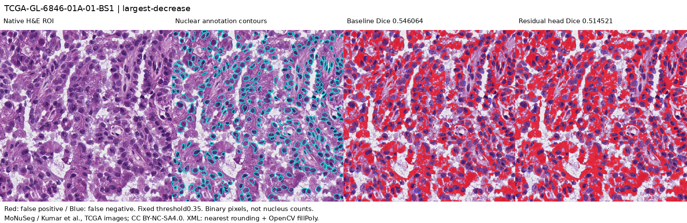

# 고정 모델의 MoNuSeg 외부 평가

**MoNuSeg 공식 test 14장·14 TCGA 케이스에서 실제 추론·정답 평가를 수행했다. 보정 모델의 평균 성능은 하락했다.** 사용자 제출 seed20261116의 두 가중치와 TNBC 검증셋에서 선택한 threshold0.35를 고정했다. 외부 데이터를 이용한 재학습, epoch 선택, threshold 조정은 하지 않았다.

| 14장 이미지별 Dice의 평균 | 기준 ViT | 보정 ViT | 보정−기준 | 상승/동일/하락 |
|---|---:|---:|---:|---:|
| 전체 | 0.551974 | 0.534943 | −0.017031 | 1/0/13 |
| 128px 패치 경계 | 0.563794 | 0.546988 | −0.016806 | 0/0/14 |
| 내부 | 0.548625 | 0.531551 | −0.017074 | 1/0/13 |

차이는 반올림 전 원본으로 계산했다. 기존 TNBC test7장이나 validation10장 평균과 합치지 않는다. [원시 이미지별 수치](../artifacts/experiments/external-monuseg-20261111/results.json).

## 데이터와 고정 조건

- [공식 MoNuSeg 데이터](https://monuseg.grand-challenge.org/Data/)의 `MoNuSegTestData.zip`, 41,620,178bytes, SHA256 `13e522387ae8b1bcc0530e13ff9c7b4d91ec74959ef6f6e57747368d7ee6f88a`를 내려받았다. 14개 TIFF와14개 XML을 ZIP 내부 바이트와 대조했다.
- 1000×1000 RGB 이미지14장, 핵 윤곽6,697개,14개 TCGA case이다. 핵 instance ID는 전경의 합집합으로 바꿔 **픽셀 분할**을 평가했다. 핵 개수·검출 AP·AJI 점수가 아니다.
- 출처는 Kumar 등 MoNuSeg 연구진과 TCGA이며 라이선스는 **CC BY-NC-SA4.0**이다. 이 보고서의 데이터 유래 마스크·그림은 같은 조건으로 제공한다. 데이터 권리와 저장소 코드 권리는 별개다. [출처·권리 근거](../artifacts/experiments/external-monuseg-20261111/source-license-evidence.json), [파일·case·MPP](../artifacts/experiments/external-monuseg-20261111/source-inspection.json).
- TNBC50장과 decoded RGB 전체 배열을 비교해 정확한 동일 이미지가 없었다. 그러나 TNBC의 익명 Slide 폴더와 TCGA 환자 ID 대응표가 없으므로 **환자 중복이 전혀 없음을 증명한 것은 아니다**. 부분 crop·근접 중복 검증도 아니다.
- 모델 SHA는 기준 `0bb2af67…972f5898`, 보정 `b9d3892a…d70f004f`로 [사용자 원본 감사](USER_REFINEMENT_AUDIT.md)의 파일과 같다. 이번에는 신뢰한 구현에서 `torch.load(weights_only=True)`로 가중치를 읽어 새 외부 추론을 실행했다. 과거 감사만 수행했던 기록과 구분한다.
- native 크기를 유지하고 RGB/255,128px 무겹침,흰색 padding,기존 조직 검사 규칙을 그대로 사용했다. 별도 stain normalization·해상도 조정은 하지 않았다. TNBC의 MPP는 알려져 있지 않아 물리 배율 일치까지 보장하지 않는다.
- XML float XY를 `np.rint`로 반올림하고 OpenCV `fillPoly`로 각 핵을 채워 합집합을 만들었다. 영상 밖으로 조금 넘어간 정점은 영상 canvas에서 잘린다. 이 좌표/채움 규칙은 명시하고 테스트했지만 **공식 MATLAB `poly2mask`와 픽셀 단위 동등성 또는 공식 leaderboard 재현을 주장하지 않는다**.
- 경계는 두 모델 모두 x/y128의 배수에 같은 ±8px band를 적용했다. Dice는 높을수록 좋고, 여기의 경계는 핵 윤곽이 아닌 **패치 처리 경계**다.

실제 추론 전 저장한 [고정 protocol](../artifacts/experiments/external-monuseg-20261111/protocol.json)을 제공한다. 수행 후 결과가 낮다는 이유로 threshold·사례·모델을 바꾸지 않았다.

## 실패 사례

전체 Dice 차이가 가장 작은 `TCGA-GL-6846-01A-01-BS1`은 **0.546064→0.514521**이었다. FP327,258→382,171, FN9,752→6,497로 누락은 줄었지만 거짓 양성이 더 늘었다. 영상의 빨강은FP, 파랑은FN이다.

유일한 상승 `TCGA-69-7764-01A-01-TS1`은 **0.695473→0.696036**, 차이+0.000563이었다. FP136,407→145,745, FN32,386→27,162였다. [해당 그림](../artifacts/experiments/external-monuseg-20261111/largest-increase.png). 두 사례는 결과를 설명하기 위해 사후 최대/최소 차이로 선택했으며 별도 대표 성능 추정치가 아니다.

## 감사와 재현

[원시 결과 ZIP](../artifacts/experiments/external-monuseg-20261111/evidence.zip)에는 동결 소스, 두 모델, 원시 확률28개, 변환한 정답14개, protocol·결과·실행 로그가 들어 있다. 원본 TIFF/XML은 공식 출처에서 받을 수 있으며 ZIP·파일 SHA를 제공한다. [파일 SHA](../artifacts/experiments/external-monuseg-20261111/file-manifest.json) · [ZIP SHA](../artifacts/experiments/external-monuseg-20261111/archive.json) · [감사 결과](../artifacts/experiments/external-monuseg-20261111/audit.json).

별도 재계산에서 원본 ZIP28파일, polygon6,697개에서 재생성한 마스크14개, 확률28개에서 계산한 **84영역의 TP/FP/FN·Dice·IoU·precision/recall 및6평균**, 차이와 상승/하락 개수가 모두 일치했다. 재사용 검사기의 입력 ZIP 연결과 전체14장·차이 집계 검증도 회귀 테스트로 보완했다. 과거 실행기의 원본은 ZIP에 그대로 남기고, 수정한 신뢰 검사기로 기존 결과를 다시 감사했다. 모델 재추론은 하지 않았다.

저장소 루트에서 새 실행은 `scripts/run_external_monuseg.py --data <공식압축해제폴더> --model-run <사용자보정run> --tnbc <TNBC폴더> --output <새폴더>`로 수행한다. 같은 Python 환경과 `PYTHONPATH=src`를 사용한다. ZIP을 푼 결과는 `PYTHONPATH=src python scripts/run_external_monuseg.py --audit <압축해제폴더>`로 새 추론 없이 검사한다.

## 해석의 범위

TNBC 검증셋에서 개선됐던 보정 모델이 이 외부 데이터에서는 낮아졌다. 데이터·염색·해상도·조직·주석 규칙의 차이와 과적합 가능성을 추가로 연구할 근거지만, 이 실험 하나로 하락의 원인을 확정하지 않는다. 현재 모델 쌍 하나·공개14ROI 평가이므로 모든 외부 기관·환자에 일반화하지 않는다.

각 이미지는 WSI에서 잘라낸 주석 영역이다. **전체 WSI의 핵 정답 기반 검증이나 임상 검증은 수행하지 않았다.** 현재 확보하지 못한 자료와 실행 조건은 [별도 상태 문서](CLINICAL_WSI_VALIDATION_STATUS.md)에 정리했다. 처리 시간은 이미지당1회 관찰값이며 반복 속도 benchmark로 사용하지 않는다.
