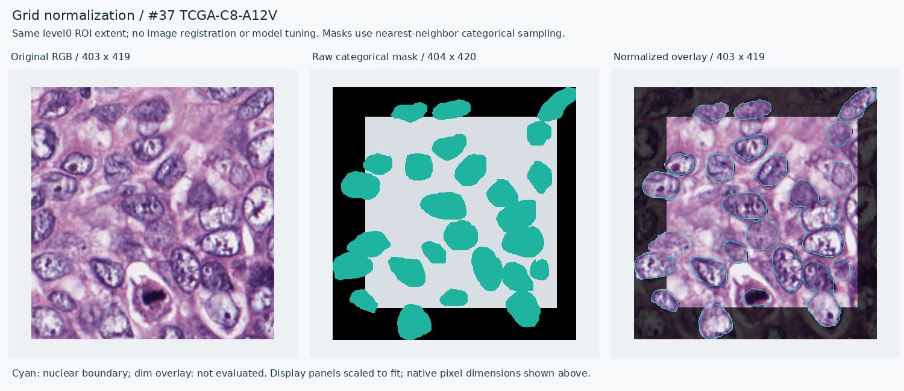
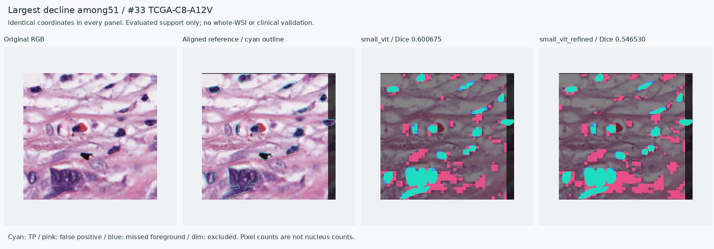

# NuCLS 36쌍 격자 불일치 처리와 전체51시야 평가

2026-11-13 KST / 2026-11-12 UTC. **보류했던36쌍의 RGB·mask 치수 차이를 명시적인 격자 정규화로 처리하고, 확보한51시야·5케이스 모두를 평가했다.** 원자료를 수정하거나 성능에 따라 사례를 제외하지 않았다. 기존15시야 결과와 증거 ZIP도 그대로 보존했다.

전체 평균 Dice는 기본 SmallViT **0.628150**, 사용자 잔차 보정 모델 **0.613006**이다. **8시야 상승·43시야 하락**이며5개 케이스 평균 모두 하락했다. 이는 보정 효과가 이 외부 자료로 일반화됐다는 근거가 아니다.

## 좌표·치수 문제를 어떻게 처리했는가

51개 원본 WSI crop과 배포 RGB의 동일 위치 연결·해시 검사는 [선행 평가](NUCLS_SP3_EVALUATION.md)에 있다. mask와 RGB가 같은 크기인15쌍, 축별 최대1px 다른36쌍이었다. MPP와 level0 영역의 연속 치수는 정수 이미지 치수와 소수점 차이가 있었지만, **어떤 과거 SP.3 exporter에서 어떤 반올림이 발생했는지까지 재현한 것은 아니다.**

[공식 NuCLS inferred-anchor exporter의150–156행](https://github.com/PathologyDataScience/NuCLS/blob/a87ac50c05cbc8ea11a41516be819f6b31436be7/interrater/scripts/i1f_parse_anchors_dataset.py#L150)은 float rounding으로 인한 작은 치수 차이를 mask의 order0 최근접 보간으로 RGB에 맞춘다. 이 코드는 다른 내보내기 경로이므로, raw SP.3의 정확한 과거 좌표 복원 근거로 확대하지 않았다. 본 실험은 이 방식을 참고해 다음 규칙을 **새 추론 전에 고정**했다.

1. 이미 원본과 연결한 RGB의 level0 영역·픽셀 격자를 기준으로 고정한다. 영상 이동이나 성능 기반 정합 탐색은 하지 않는다.
2. mask의 가로·세로 크기가 각각 최대1px 다른 경우만 허용한다. 전체 범위의 픽셀 중심을 기준으로 최근접 원본 픽셀을 선택한다. 클래스·인스턴스 ID의 **3채널 묶음 전체**를 복사하며 ID를 선형 보간하지 않는다.
3. 원 mask/CSV에서 만든 기존 정답·유효 영역·제외 영역을 같은 인덱스로 옮긴다. 미주석0·불명99, 사각형·불명 윤곽, CSV/mask 모순 픽셀의 제외 정책은 유지한다. 정규화된 표시용 polygon을 다시 채워 평가 정답을 바꾸지 않는다.
4. 표시용 CSV의 정수 중심 좌표는 `(좌표+0.5) × RGB크기/mask크기 − 0.5`로 변환한다. 연속 이미지 경계 좌표는 `(0,0)–(W,H)`를 동일한 level0 범위에 대응시킨다. 원 CSV도 보존한다.
5. 크기가 같은15쌍은 픽셀 단위 항등 변환이다. 기존 정답·평가 영역·예측을 그대로 재사용한다.

실제 구현은 **SciPy1.18.1의 `zoom(order=0, grid_mode=True, prefilter=False, mode="nearest")`** 인덱스 규칙이며 NumPy2.5.4를 사용했다. 404→403 변환의 정확히 반 픽셀에 걸리는 위치에서 단순 정수식과 라이브러리의 부동소수점 tie 처리가 다름을 발견해 회귀 테스트를 추가했다. 실험 재현 시 `requirements-lock.txt` 버전을 사용한다. 이는 유일하게 참인 과거 좌표를 증명하는 규칙이 아니다.

[구현](../src/pathology_edge/annotation_grid.py) · [51쌍 좌표·치수 표](../artifacts/experiments/nucls-alignment-20261113/grid-map.csv) · [추론 전 검사](../artifacts/experiments/nucls-alignment-20261113/alignment-preflight.json) · [공식 소스 출처·해시](../artifacts/experiments/nucls-alignment-20261113/source-provenance.json)

## 정렬 결과를 직접 볼 수 있는 자료

아래는 성능과 무관하게404→403 tie 조건으로 고른 C8-A12V 시야다. 원 mask404×420을 고정 RGB403×419 격자에 대응시켰다. 오른쪽 청록 윤곽은 변환된 정답이며 어두운 부분은 평가 제외 영역이다. 그림은 보기 좋게 배치한 화면으로, 실제 픽셀 크기는 각 패널 제목에 표시했다.



36쌍 모두의 원영상·오버레이를 [1–12](../artifacts/experiments/nucls-alignment-20261113/figures/normalized36-sheet-1.png), [13–24](../artifacts/experiments/nucls-alignment-20261113/figures/normalized36-sheet-2.png), [25–36](../artifacts/experiments/nucls-alignment-20261113/figures/normalized36-sheet-3.png)에서 확인할 수 있다. 개발 환경에서 세 모음 그림과 상세 사례를 살펴봤으며 눈에 띄는 잘못된 짝·큰 위치 이동은 관찰되지 않았다. 이는 전문가 주석 정확성이나 모든 소수점 좌표의 인증이 아니다.

추가 ZIP에는51개의 완전한 클래스/인스턴스 채널을 가진 `aligned_masks/*.png`, 원 좌표와 변환 좌표의 연결, 정답/유효/제외 mask가 들어 있다.36개는 정규화,15개는 원본 픽셀과 동일하다. 원본153개 파일은 선행 ZIP에서 읽는다.

## 실제 고정 모델 결과

사용자가 실행한 seed20261116 두 체크포인트를 그대로 사용했다. threshold0.35, 128px 무겹침 파이프라인, ROI 내부 타일 절단선 ±8px를 유지했다. 새 학습·threshold 조정·외부 데이터에 맞춘 모델 선택은 없다. 이 비교는 **SmallViT 기본/잔차 보정 비교**이며 데모의 무겹침/겹침 비교와 다르다.

| 51시야의 이미지별 평균 Dice | 기본 | 보정 | 보정−기본 |
|---|---:|---:|---:|
| 유효 주석 전체 | 0.628150 | 0.613006 | -0.015143 |
| 패치 경계 | 0.631277 | 0.617220 | -0.014057 |
| 패치 내부 | 0.624635 | 0.609210 | -0.015424 |

| 집단 | 시야 | 케이스 | 기본 Dice | 보정 Dice | 상승 / 동일 / 하락 |
|---|---:|---:|---:|---:|---:|
| 이전 치수 일치 집단 | 15 | 4 | 0.637160 | 0.625636 | 5 / 0 / 10 |
| 추가 격자 정규화 집단 | 36 | 5 | 0.624395 | 0.607744 | 3 / 0 / 33 |
| 전체 | 51 | 5 | 0.628150 | 0.613006 | 8 / 0 / 43 |

| 케이스 | 시야 수 | 기본 Dice 평균 | 보정 Dice 평균 | 차이 |
|---|---:|---:|---:|---:|
| TCGA-A1-A0SP | 11 | 0.655800 | 0.647587 | -0.008213 |
| TCGA-A7-A0DA | 15 | 0.606618 | 0.589929 | -0.016689 |
| TCGA-AR-A1AR | 5 | 0.617668 | 0.587369 | -0.030298 |
| TCGA-C8-A12V | 13 | 0.651459 | 0.643981 | -0.007478 |
| TCGA-E2-A158 | 7 | 0.595036 | 0.568905 | -0.026131 |

5개 케이스를 동일 가중한 평균은 **0.625316→0.607554**다.51개 시야 평균과 분모가 다르다. 유효 주석 픽셀은 **5,216,045**, 그 안의 전경은 **1,162,644**이다. 클래스1–12의 합집합(주석에 포함된 apoptotic body 등 포함)을 이진 전경으로 평가했으며 픽셀 수는 핵 개수가 아니다. CSV/mask 모순 제외 전 support의 평균도 **0.625872→0.611174**로 하락했다.

가장 크게 하락한 시야는 이전15개에서도 확인한 C8-A12V 사례다. Dice0.600675→0.546530, FN1,017→731px지만 FP10,460→14,068px로 증가했다. 새36개를 포함해도 같은 사례가 최대 하락이었다.



## 검증과 재현

- 새 grid 계약 테스트27개와 기존 WSI·외부 평가·보정 관련59개, 합계 **86개 통과**. 항등 변환·축별 차이·ID 보존·제외 영역·level0 모서리·잘못된 입력·tie 처리를 확인했다.
- 51개 모두에서 최근접 변환을 독립적인 전체 배열 연산으로 다시 만들고 동일함을 확인했다. 새 클래스/인스턴스 tuple 생성이나 기존 핵 tuple 소실은 없었다. 정규화가 윤곽의 픽셀 면적까지 보존한다는 뜻은 아니다.
- 저장된 지표 **408개**, 집계 평균 **160개**를 별도 산술로 검산했다. 원자료153개·원본 crop51개·모델과 소스 해시를 대조했으며 기존15개의 지표가 그대로임을 확인했다.
- 지표·평균·예측 재사용 여부를 변조한3개 부정 검사를 모두 거절했다. [검산 결과](../artifacts/experiments/nucls-alignment-20261113/independent-audit.json).
- 새36시야 × 두 모델 = **72회 추론**, 기존15시야 × 두 모델의 **30개 저장 확률 재사용**이다. 기존 원본/제공 RGB 비교 전체60회를 재실행한 것이 아니다. 이번 시간 기록은 단일 실행이며 속도 비교 실험이 아니다.
- 구현·추론·검산·위 그림 확인은 **제공된 개발 환경에서 수행**했다. 사용자 작성7개 코드 범위를 수정하지 않았다. 사용자의 이번51시야 재평가 실행·정렬 그림 직접 확인은 아직 확인하지 않았다. U84/U85는 이전15개 평가의 표시 확인·선택 편향 해석으로 보존한다.

[추가 증거 ZIP](../artifacts/experiments/nucls-alignment-20261113/evidence.zip)은 **선행 증거 ZIP에 의존하는 보충 파일**이다. 모델·원본153개를 중복 넣지 않았다. 선행 ZIP SHA256은 `ae7b3ac863c02ddab9e1c6f52155465df7ebf366680f16e708fd7b0e798be9e8`이며 내용이 그대로임을 재확인했다. 저장소 루트에서, 의존성이 설치된 Python 환경으로 실행한다.

```bash
# 서로 다른 새 폴더에 원본과 보충 증거를 풉니다.
python -m zipfile -e artifacts/experiments/nucls-sp3-20261113/evidence.zip work/nucls-base-audit
python -m zipfile -e artifacts/experiments/nucls-alignment-20261113/evidence.zip work/nucls-alignment-audit
# 저장 확률과 원자료만 읽어 대조합니다. 추론·학습은 실행하지 않습니다.
python scripts/audit_nucls_alignment.py --base work/nucls-base-audit --supplement work/nucls-alignment-audit
# 새로운 빈 출력 폴더로만 재평가하려면(36×2 추론 실행):
# PYTHONPATH=src python scripts/run_nucls_alignment.py --base work/nucls-base-audit --output work/nucls-alignment-rerun
```

## 해석의 한계

36개를 치수 때문에 제외한 문제는 위 규칙으로 해소했고, 이번 결과는 확보한 SP.3 U-control51개 모두를 포함한다. 그러나 **51개가 독립 환자51명인 것은 아니며5케이스**다. A0SP는 이전 PanopTILs 외부 평가와 겹쳐 새 독립 환자로 다시 세지 않는다. 나머지4케이스도 모든 공개 자료에 대해 독립성이 입증됐다는 뜻은 아니다.

과거 raw SP.3 내보내기의 정확한 소수점 좌표·래스터화 의도는 복원하지 못했다. 별도 intended-FOV 좌표도 확보하지 못해 **명시적으로 주석된 유효 픽셀 범위**만 평가한다. 미주석을 배경으로 채우거나 모든 조직·모든 핵이 정답 검증됐다고 표현하지 않는다. 임상 검증·전체 WSI 핵 정답 기반 검증·Ki67 임상 지수 검증은 여전히 미실시다.

NuCLS 공개 자료 CC0 1.0, Amgad et al., [NuCLS 논문](https://arxiv.org/abs/2102.09099), [자료 형식](https://sites.google.com/view/nucls/data-format), [SP.3 설명](https://sites.google.com/view/nucls/multi-rater)을 출처로 삼았다. 원본 SVS는 GDC의 공개 파일이며 UUID·MD5·영역 연결은 선행 증거에 있다.
