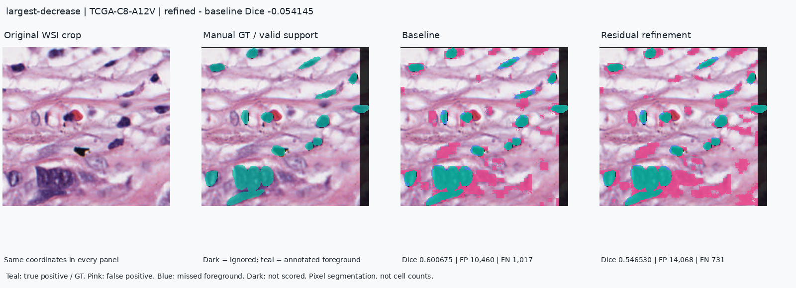
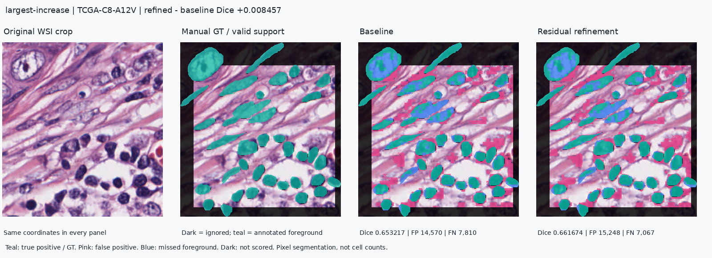

# NuCLS SP.3 수작업 윤곽과 원본 WSI 연결 평가

2026-11-13 KST / 2026-11-12 UTC. **공개 원자료를 실제 확보하고, 5개 원본 WSI와 연결한 뒤 기술 검사에 통과한 15개 시야·4개 케이스에서 고정 모델을 평가했다.** 전체 주석 영역 Dice는 0.637160→0.625636으로 낮아졌다. 보정 효과의 일반화를 입증한 결과가 아니다. 임상 검증·전체 WSI 핵 정답 검증은 미실시 상태를 유지한다.

## 무엇을 확보하고 대조했는가

- [공식 NuCLS 설명](https://sites.google.com/view/nucls/multi-rater)의 **SP.3 U-control** 전체 목록에서 51개 CSV·51개 RGB·51개 mask, 총153개 파일을 받았다. 해당 자료는 공식 안내의 CC0 1.0 대상이다. 다른 평가자의 사각형 자료나 통계적 P-truth를 수작업 윤곽으로 바꾸지 않았다.
- 5개 정확한 DX1 파일명을 GDC UUID와 연결하고 원본 SVS 총 **5,082,513,388bytes(약5.08GB)**를 스트리밍으로 읽었다. **5/5개 MD5가 GDC 공개 기록과 일치**했다. ROI 읽기에 사용한 byte range도 같은 전체 스트림과 대조했다. 전체 파일을 디스크에 보관하거나 전체 슬라이드를 추론한 것은 아니다.
- 원본의 level0 타일에서 51개 영역을 직접 디코딩하고, 제공 RGB의 원래 크기로 BILINEAR 리사이즈했다. ICC·염색 보정·정답 기반 정합 보정은 적용하지 않았다. 실제 MPP는 약0.2µm/px이며 영역별 정확한 값과 좌표 변환 조건은 acquisition 기록에 있다.
- 같은 위치의 원본 재독출 RGB와 배포 RGB의 상관계수 최솟값은 **0.998578**였다. 위상 상관의 축별 이동량 절댓값은 최대 **0.511052px**로 기록했고 이를 보정에 사용하지 않았다. 네 평가 케이스의 사전식 첫 시야를 원본·배포 RGB·정답 오버레이로 직접 살펴봤다. 픽셀별 완전한 동일성이나 전문가 판독 정확성을 인증한 것은 아니다.

[원본/정답 연결 화면](../artifacts/experiments/nucls-sp3-20261113/linkage-contact-sheet.png) · [원본 및 전체 스트림 감사](../artifacts/experiments/nucls-sp3-20261113/original-acquisition.json) · [153개 원자료 ID/해시](../artifacts/experiments/nucls-sp3-20261113/annotation-acquisition.json)

## 실제 파일에서 발견한 차이와 제외 규칙

공식 소개는 SP.3 수작업 경계1,223개라고 설명하지만, 실제 CSV1,223행은 **polyline1,221행·rectangle2행**이었다. 분류가 `unlabeled`인 윤곽32행도 있다. 이 숫자는 주석 행 수이며 전 슬라이드의 고유 핵 개수가 아니다.

**51쌍 중36쌍은 RGB와 mask의 가로 또는 세로 크기가1px 다르다.** 어느 쪽의 좌표 반올림인지 확정하지 못했으므로, 마스크 리사이즈·이동·임의 공통 crop으로 맞추지 않았다. 모든51쌍을 확보한 뒤, **추론 전에 크기가 정확히 일치하는15쌍만 선정**했다. 나머지36개는 결과가 나빠서 뺀 것이 아니며, 그 목록·원래 치수·제외 사유를 [protocol](../artifacts/experiments/nucls-sp3-20261113/protocol.json)에 남겼다. 그 중 E2-A158은7쌍 모두 제외되어 최종 평가 케이스는5개가 아닌4개다. 제외가 많은 편의 표본이라는 한계가 있다.

평가 해석은 [공식 데이터 형식](https://sites.google.com/view/nucls/data-format)에 따른다.

- mask 첫 채널의 핵 구조 코드1–12를 전경, FOV 코드253을 명시적 배경으로 해석한다. 미주석0·분류 불명99는 배경으로 간주하지 않는다. 클래스 분류나 인스턴스 검출 정확도는 평가하지 않는다.
- CSV 사각형의 포함 경계 전체와 unlabeled 윤곽은 제외한다. 정수 좌표의 Pillow polygon과 원 mask의 전경/배경이 불일치하는 픽셀도 주 평가에서 제외한다. 과거 exporter의 정확한 rasterization 재현이라고 주장하지 않는다.
- 이번 공개 폴더에서 별도 intended-FOV 위치 CSV는 확보하지 못했다. 따라서 **명시적으로 주석된 픽셀의 support 평가**라고 부른다. FOV 밖으로 뻗어나간 주석 핵은 포함될 수 있지만, 미주석 영역을 배경으로 채우거나 ROI 전체가 빠짐없이 검증됐다고 표현하지 않는다.
- 선정15개 CSV에는379행(윤곽378·사각형1)이 있고, 윤곽 중7행은 unlabeled다. 최종 유효 **1,543,336px**, 그 안의 정답 전경 **355,686px**를 평가했다. 픽셀 수를 핵 개수로 해석하지 않는다.

## 고정 모델의 실제 결과

사용자 seed20261116 기준/보정 체크포인트와 threshold0.35를 그대로 사용했다. 원래128px 무겹침·조직 검사·확률 결합 파이프라인이며 새 학습이나 외부 데이터 기반 선택은 없다. 두 모델은 TNBC에서 선택된 모델이므로 해상도·기관·염색 차이의 영향을 분리한 실험은 아니다.

| 15개 시야의 이미지별 평균 Dice | 기준 SmallViT | 잔차 보정 | 보정−기준 |
|---|---:|---:|---:|
| 유효 주석 전체 | 0.637160 | 0.625636 | -0.011524 |
| 패치 경계 | 0.645178 | 0.640587 | -0.004591 |
| 패치 내부 | 0.631825 | 0.618902 | -0.012923 |

전체 점수는 **5개 시야 상승·10개 하락**이다. 여기서 경계는128px 타일 절단선 ±8px와 유효 주석의 교집합이며, 핵 윤곽선의 경계 정확도가 아니다. 이 비교는 **기준/보정 모델 비교**이며 기존 TNBC의 **무겹침/겹침 비교**와 다른 실험이다.

| 케이스 | 선정 시야 수 | 기준 Dice 평균 | 보정 Dice 평균 | 차이 |
|---|---:|---:|---:|---:|
| TCGA-A1-A0SP | 3 | 0.617637 | 0.613138 | -0.004498 |
| TCGA-A7-A0DA | 6 | 0.632744 | 0.617422 | -0.015322 |
| TCGA-AR-A1AR | 1 | 0.621483 | 0.593712 | -0.027770 |
| TCGA-C8-A12V | 5 | 0.657307 | 0.649376 | -0.007931 |

네 케이스 평균 모두 낮아졌다. 케이스에 동일 가중치를 준 평균은 **0.632293→0.618412**다. 15개 시야를15명의 환자로 세거나 통계적으로 유의한 임상 차이라고 주장하지 않는다. 시야 간 겹침 가능성과 한 명의 SP.3 주석에 의존한다는 한계도 있다.

**이전 자료와의 중복:** TCGA-A1-A0SP는 앞선 PanopTILs 연구 평가에도 등장했다. 이번 네 케이스 중 새로 평가한 환자는 A7-A0DA·AR-A1AR·C8-A12V 세 케이스다. 같은 환자의 새 주석/영역을 독립 환자로 추가하지 않는다. MoNuSeg 공식test14케이스와는 TCGA 케이스 ID가 겹치지 않는다. 이 확인을 공개 데이터 전체의 환자 비중복 증명으로 확대하지 않는다.

보조 검사에서도 결론은 같았다. 동일15개 시야의 **배포 RGB 입력**은0.636628→0.625382, 원본 입력의 **CSV/mask 불일치를 추가 제외하기 전 support**는0.634366→0.623123이었다. 같은 시야의 렌더링/평가 규칙 민감도 비교이며 독립 표본 추가가 아니다. 점수를 보고 규칙을 바꾸지 않았다.

## 개선·악화 사례

최대 하락 시야는 C8-A12V, level0 `(12079,57471)–(12351,57729)`다. Dice **0.600675→0.546530**. 놓친 전경은1,017→731px로 줄었으나 거짓 양성이10,460→14,068px로 늘었다. 286개의 추가 TP를 추가 검출한 핵286개라고 표현할 수 없다.



최대 상승 시야도 C8-A12V이며 Dice **0.653217→0.661674**였다. 전체 평균의 악화와 개별 개선은 함께 존재한다.



그림에서 청록은 정답/맞힌 전경, 분홍은 FP, 파랑은 FN, 어두운 곳은 평가 제외다. 모든 패널은 같은 입력 좌표를 사용하며 실제 저장 확률에서 만들었다.

## 검증·재현·직접 수행 구분

- 새 주석 해석의 합성 계약 검사 **14개 통과**. 미주석/불명 코드, 사각형 제외, 양방향 윤곽 불일치, 잘못된 주석·코드를 검사했다.
- 기존 WSI 원본 읽기·PanopTILs·외부 평가·보정 통합 관련 **59개 회귀 검사 통과**. 이번에 전체 프로젝트 테스트나 데모 배포를 새로 실행했다고 기록하지 않는다.
- 저장된 확률의 지표 **240개와 집계 평균96개**를 별도 산술로 재계산해 일치했다.153개 원자료,51개 원본 crop, 고정 모델·소스·프로토콜 해시도 대조했다. [독립 검산](../artifacts/experiments/nucls-sp3-20261113/independent-audit.json).
- 추론은15개 시야 × 원본/배포RGB × 두 모델 = **60회** 실행했다. 학습0회, 보류36개 시야의 추론0회다. 단일 실행 시간은 기술 기록이며 속도 우위의 근거로 쓰지 않는다.
- 위 확보·구현·추론·검산·화면 검토는 **제공된 개발 환경에서 수행**했다. 사용자의 기존 보정 모듈·좌표·Dice 구현을 유지했다. 발행 후 사용자가 최대 악화 사례의 원본·정답·기준·보정 네 패널 표시를 확인해 [U84](CONTRIBUTIONS.md)에 기록했다. 사용자 새 실행·결과 해석은 아직 확인하지 않았다. 증거 ZIP 안의 보고서와 감사 결과는 발행 당시 기록을 유지한다.

[재현 증거 ZIP](../artifacts/experiments/nucls-sp3-20261113/evidence.zip)에는 원자료/좌표·선정/보류 목록·원본 crop·고정 체크포인트·소스·예측·검사 로그가 있다. 약5GB의 전체 SVS를 담은 파일은 아니다. 저장소 루트에서 별도 폴더에 풀어 검산한다. 프로젝트 의존성이 설치된 Python 환경을 사용한다.

```bash
python -m zipfile -e artifacts/experiments/nucls-sp3-20261113/evidence.zip work/nucls-sp3-audit
python work/nucls-sp3-audit/audit_results.py work/nucls-sp3-audit
```

이 명령은 모델을 불러오거나 추론하지 않고 저장된 근거만 검사한다. 기존 최종 전달 ZIP은 발행 당시 기록으로 보존하고 본 보고서를 후속 자료로 연결한다.

## 남은 문제

36쌍의 RGB/mask 치수 불일치와 intended-FOV 메타데이터 문제는 해결되지 않았다. 이 평가로 전체 WSI 핵 검증 또는 임상 검증이 완료된 것은 아니다. 현재 단계는 **공개 수작업 주석과 실제 원본의 연결·제한된 연구 평가 완료**이며, 임상 연구자 섭외를 사용자에게 요구하는 단계가 아니다.
