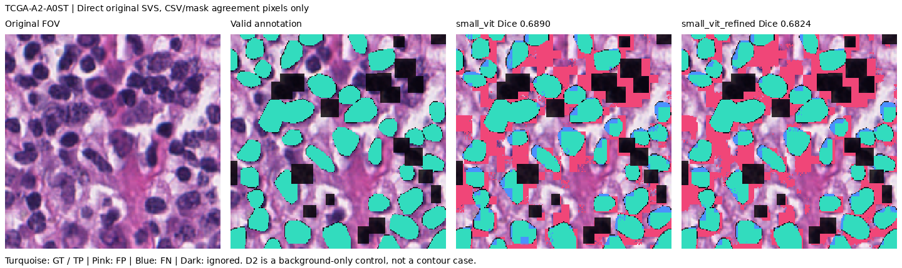
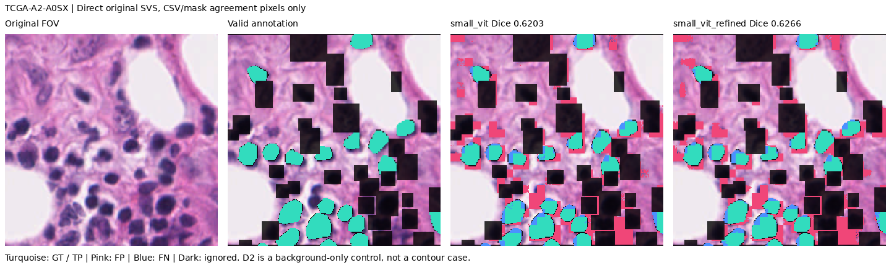

# 원본·주석 연결과 실제 평가

2026-11-12 UTC. 조사 문서의 링크만 확인하는 데서 그치지 않고, **새 WSI 3개 원본의 전체 바이트와 연결 ROI·원주석**, **BCData 공식 test 402장·804개 HDF5**를 확보·대조한 뒤 고정 모델을 평가했다. 기존 모델·결과는 보존했다.

| 완료한 연결 | 실제 평가 단위 | 관측 결과 |
|---|---|---|
| GDC 원본 SVS 2개 ↔ ROI ↔ CSV 윤곽·mask | A0ST/A0SX의 평가 가능 픽셀, 2case 평균 | 기준/보정 Dice **0.654638 / 0.654510**, 1상승·1하락 |
| 공개 미러 원본 SVS 1개 ↔ ROI ↔ 사각형 주석 | A0D2는 윤곽 정답이 없어 배경 대조로 분리 | 유효 배경35,205px 중 FP **4,796 / 4,984** |
| BCData 공식 test PNG ↔ 같은 ID의 양성·음성 HDF5 | 402ROI·중복 정리 후65,165개 제공 중심 | Accuracy **19.97%**, ROI 양성률 MAE **44.74%p** |

이 작업은 실제 원자료에 기반한 연구 평가다. 전체 슬라이드의 모든 핵 정답 평가나 임상 환자 코호트·전문가 눈가림 판독을 수행한 것은 아니다. [전체 IHC 결과·연결 사례](BCDATA_FULL_TEST.md)를 별도로 제공한다.

## WSI 원본 연결: 파일명만 같다는 것으로 끝내지 않음

앞서 사용한 PanopTILs 수동 자료의 초기 공개 목록에서, 아직 예측하지 않은 남은 3case마다 사전식 첫 ROI를 골랐다. 기존에 평가한 3case와 겹치지 않는다. 전체 데이터의 대표 표본이나 무작위 표본은 아니다. [원본/주석 식별자·고정 조건](../artifacts/experiments/original-wsi-pairs-20261112/protocol.json)에 Drive 원주석 ID, 정확한 DX1 파일명, GDC UUID, 원본 크기와 MD5가 있다.

- **A0ST:** GDC `95ff8d8c-f9d3-40cd-8fd8-232b3163e680`, 722,419,787bytes. 전체 직접 배포 파일의 MD5 `69ad852c4fde246c6e276195fc651904`가 공식 기록과 일치했다.
- **A0SX:** GDC `64093c9e-aebe-4367-adbb-3ea85e3234c9`, 1,315,819,883bytes. 전체 직접 배포 파일의 MD5 `ba27c8f0c392bb069ef3ffe9b609fd39`가 공식 기록과 일치했다.
- **A0D2:** 공개 Histomics 원본 SVS 1,782,750,153bytes 전체를 읽고 SHA-256 `b92f37e306875d1af36c857a8f772c65df5408d65f3df4780785cd506c5757cf`를 산출했다. 현재 GDC 조회에서는 같은 DX1 파일을 찾지 못해 **독립 배포기관 MD5와 일치한 사례로 세지 않는다.** 같은 환자의 TSB/BSB 파일로 바꾸지 않았다.

채택한 세 원본의 총 **3,820,989,823bytes**를 스트리밍으로 해싱했다. TIFF 메타데이터와 ROI 타일을 읽을 때 사용한 byte range도 해당 전체 스트림과 비교했다. SVS 전체를 디스크에 영구 보관한 것은 아니며, 원본 URL·해시와 실제 native crop·평가 입력은 보존한다. 나중에 다시 읽은 GDC 치수/MPP 메타데이터는 별도 요청이며 그 재요청까지 새 전체 스트림에 결합해 검사했다고 주장하지 않는다.

**미러 불일치도 남겼다.** 처음 읽은 A0ST/A0SX 미러는 GDC와 파일명·크기가 같았지만 전체 MD5가 달라 엄격 검사를 중단했다. 이후 GDC 직접 배포 원본을 읽어 공식 MD5 일치를 확인했다. 두 출처의 해당 native ROI RGB는 픽셀 단위로 정확히 같았다. 차이가 파일의 어느 부분에서 생겼는지는 규명하지 않았으므로 미러 전체가 같은 바이트라고 표현하지 않는다. [실패 로그](../artifacts/experiments/original-wsi-pairs-20261112/acquisition.log)와 [직접 GDC 대조](../artifacts/experiments/original-wsi-pairs-20261112/direct-gdc.log)를 보존했다.

TIFF page0의 원래 좌표에서 필요한 압축 타일만 디코딩한 다음 Pillow BILINEAR로1024²를 만들었다. ICC 프로파일·염색 보정·정답 기반 이동 보정은 적용하지 않았다. 제공된1024² RGB와의 픽셀 차이도 남으며 실제 출력 해상도는 약0.30µm/px다. 공식 소개의0.25µm/px와 같다고 가정하지 않는다.

## 원주석 대조로 발견한 문제와 평가 범위

원 CSV의 `rectangle`과 `polyline`을 직접 구분했다. A0D2에는 **사각형14개, 윤곽선0개**가 있었다. 단순 사각형 범위 제외 후에도 mask에는 왼쪽 한 픽셀 띠로 전경99px가 남았다. 이99px를 핵 윤곽 정답으로 사용할 수 없다.

새 예측 전에 다음 보수적 규칙을 고정했다. 기존 FOV·제외 코드·사각형 제외 규칙에 더해, CSV 정수 윤곽을 **전체 canvas의 Pillow polygon(outline=1,fill=1)**으로 만들고 원 mask와 일치하는 픽셀만 평가한다. 원 mask 전경인데 CSV 윤곽 밖이거나, 원 mask 배경인데 CSV 윤곽 안인 픽셀은 **무시**한다. 정답을 반전하거나 원파일을 수정하지 않는다.

이는 새로 명시한 일치 영역 검사 방식이며 2021년 배포 도구의 정확한 재현은 아니다. 경계의 불일치 픽셀을 제외하면 어려운 픽셀이 빠질 수 있으므로 완전한 윤곽 평가로 일반화하지 않는다. 원 CSV/min-max 범위가 같다는 것도 확인했지만 mask와의 차이 원인을 단정하지 않는다.

| 새 case | polyline / rectangle | 추가 제외: 전경 / 배경 불일치 | 최종 유효 픽셀 | 유효 정답 전경 |
|---|---:|---:|---:|---:|
| A0D2 | 0 / 14 | 99 / 0 | 35,205 | **0** |
| A0ST | 40 / 20 | 260 / 727 | 39,328 | 13,194 |
| A0SX | 20 / 32 | 143 / 276 | 34,081 | 4,788 |

따라서 핵 전경 성능의 주요 평균은 **윤곽 정답이 있는 A0ST·A0SX 두 case**만 사용한다. A0D2는 사전에 고른 사례에서 빼거나 다른 좋은 영상으로 바꾸지 않고, 별도 배경 대조로 보고한다. 평가 영역은 각각1024² 입력의 약3.25–3.75%다.

## 실제 모델 결과와 같은 위치의 실패 사례

사용자 seed20261116 SmallViT/잔차 보정 모델과 threshold0.35를 고정했다. 기존128px 무겹침·조직 검사 파이프라인이며 새 학습이나 외부 threshold 선택은 없다.

| 원본 SVS 입력 | 기준 Dice | 보정 Dice | 보정−기준 |
|---|---:|---:|---:|
| A0ST | 0.688996 | 0.682380 | −0.006616 |
| A0SX | 0.620281 | 0.626640 | +0.006359 |
| **두 case 평균** | **0.654638** | **0.654510** | **−0.000128** |
| 두 case 패치 경계 평균 | 0.680348 | 0.671647 | −0.008701 |
| 두 case 내부 평균 | 0.647770 | 0.649617 | +0.001847 |

‘경계’는128px 패치 절단선 ±8px와 유효 정답의 교집합이며 핵 표면 지표가 아니다. A0ST는 놓친 전경이1,623→1,208px로 줄었지만 거짓 양성이8,823→9,950px로 늘어 Dice가 낮아졌다. A0SX는 FP4,056→4,213px, FN812→681px였고 Dice는 높아졌다.





청록은 정답/맞힌 전경, 분홍은 FP, 파랑은 FN, 어두운 픽셀은 제외 영역이다. 같은 입력·좌표의 실제 저장 결과다.

같은 주석에 **원배포 RGB**를 넣은 보조 비교에서는 두 case 평균0.682106→0.684445였다. 별도 case가 추가된 것이 아니라 같은 두 영역의 렌더링 차이 확인이다. 원본 재독출과 제공 RGB 사이의 점수 차이가 보정 모듈 차이보다 크므로, 영상 생성 조건을 무시하고 미세한 모델 차이를 일반화할 수 없다.

## 앞선 3case 결과의 정정 근거

이번 대조 규칙으로 앞선3case 원 mask/CSV도 점검하니 전경82·34·91px와 배경383·169·183px가 불일치했다. 기존 확률을 **새 추론 없이** 다시 평가하면 엄격 일치 영역의 평균 Dice는 **0.481569→0.437627**이다. 이전0.479080→0.435576과 보정 성능 하락이라는 결론은 같지만 평가 픽셀 분모는 다르다. [별도 재평가](../artifacts/experiments/original-wsi-pairs-20261112/previous-three-rescore.json)를 제공하고 기존 기록은 덮어쓰지 않았다.

## 검증과 재현

- 원본 범위 응답·길이·전체 스트림·MD5 불일치 거부, 타일 경계 crop, 주석 불일치 처리 테스트를 실행했다.
- 합성 JPEG 타일 TIFF에서4개 crop이 전체 디코딩 후 잘라낸 픽셀과 정확히 일치했다.
- 저장된 새 확률로 **36개 평가 영역·12개 평균**을 재계산했고 원 mask/CSV 평가 영역도 재구성했다. 모델·입력·소스는 예측 전에 해시로 고정했다.
- IHC는1,206개 입력과402개 예측 결과, 하위집단·최대/최소 사례를 독립 검산했다. [세부 검사](BCDATA_FULL_TEST.md).

[원본·모델·주석·예측 증거 ZIP](../artifacts/experiments/original-wsi-pairs-20261112/evidence.zip)을 저장소 루트에서 새 폴더로 풀어 감사할 수 있다:

```bash
python -m zipfile -e artifacts/experiments/original-wsi-pairs-20261112/evidence.zip work/original-pair-audit
PYTHONPATH=work/original-pair-audit/source python work/original-pair-audit/runner.py --audit work/original-pair-audit
```

WSI byte-range 획득 도구는 기존 환경 외에 `tifffile==2026.11.8`, `imagecodecs==2026.3.6`을 별도 폴더에 설치해 사용했다. 실제 최초 미러 실패와 GDC 직접 재확인·입력 연결을 수행한 연구 스크립트도 근거 폴더에 있다. 이후 획득 CLI는 정확한 GDC 파일이 있으면 이를 우선한다. 모든 저장 데이터로 새 학습을 하지 않았으며 이 작업을 사용자 직접 실행·임상 전문가 판독으로 기록하지 않는다.

검증 마무리: [Ubuntu CI](https://github.com/sokldjs554/pathology-edge/actions/runs/43156022905)에서 코드 `ffbeabd`의 **435개 테스트**가 통과했다. 별도 IHC 주석 처리 회귀 검사4개도 통과했다. 로컬 광범위 검사는 임시 복제본으로 디스크가 가득 차386통과·39오류·2제외였으며 성공으로 기록하지 않았다. 새 원격 환경에서 전체 검사를 완료했다. 기존 보호 파일2,731개의 SHA는 변경0이고, 공개 증거 ZIP63,937,336bytes를 다시 받아 해시 일치를 확인했다.
