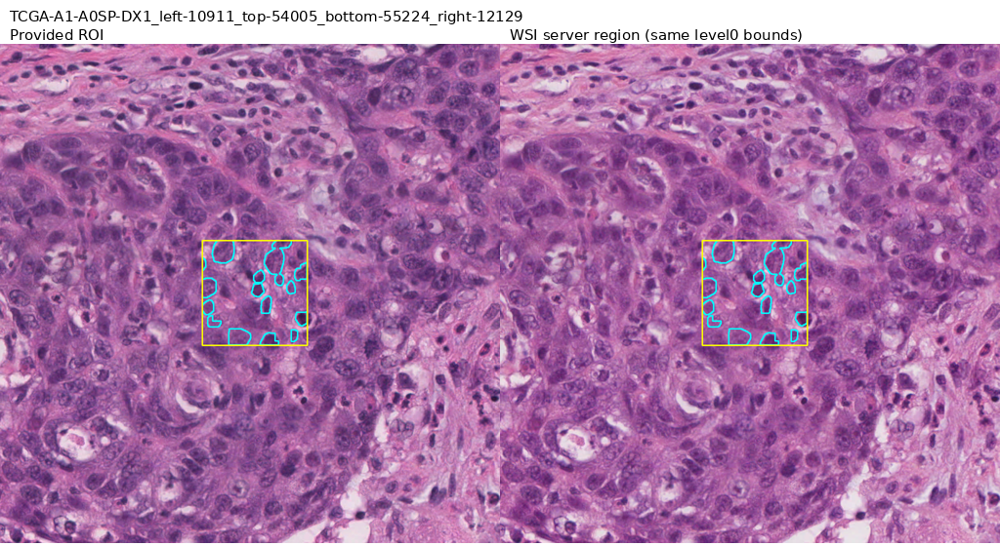
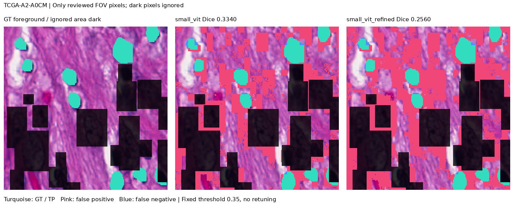

# 실제 WSI에 연결한 PanopTILs 부분 정답 평가

2026-11-12: 공개 WSI 서버에서 **서로 다른 TCGA case 3개의 ROI를 직접 읽고**, 고정한 사용자 SmallViT와 보정 모델을 적용했다. 평가 가능한 픽셀의 이미지별 Dice 평균은 **0.479080 → 0.435576**으로 세 사례 모두 하락했다. 이는 **일부 주석 영역의 탐색적 평가**이며 전체 WSI 핵 정답 검증이나 임상 검증 완료가 아니다.

## 원자료와 선택 기준

사용자가 올린 `PathologyEdge_WSI_자료조사.zip`은 Markdown 조사 문서 3개였으며 원본 영상·주석·임상 코호트는 포함하지 않았다. ZIP SHA-256은 `3533a6d48c50b652ec0d874cacba328250ff5cc16e839748be1640cd0d2ab6e6`이다. 문서 안의 제안은 조사 단서로 사용하고 실제 원자료를 별도로 확인했다.

[PanopTILs 공식 사이트](https://sites.google.com/view/panoptils/home)의 **ManualNucleiManualRegions_06062021** 배포를 사용했다. 학습용 자동 확장 주석이나 후속 모델로 보정한 자료로 대체하지 않았다. 공식 사이트의 데이터 라이선스는 **CC0-1.0**이다. [수동 검증 자료 폴더](https://drive.google.com/drive/folders/17HvYYPkBOyeexXetxih5q8KxJUlt6aRT)의 RGB·mask·CSV 첫 공개 목록에 공통으로 있는 case를 사전식 정렬하고, 앞 3개 case에서 첫 ROI 하나씩 고정했다. 웹 목록은 각각 최대 50개 항목을 보여 주므로 전체 자료의 무작위 표본이 아니다. 예측을 보고 고르거나 교체하지 않았다.

| TCGA case | level-0 영역: left, top, right, bottom | 평가 가능 픽셀 / 1024² | 기준 Dice | 보정 Dice |
|---|---|---:|---:|---:|
| A1-A0SP | 10911, 54005, 12129, 55224 | 31,712 / 1,048,576 (3.02%) | 0.717024 | 0.699691 |
| A2-A0CM | 19624, 56888, 20861, 58124 | 30,990 / 1,048,576 (2.96%) | 0.334046 | 0.255952 |
| A2-A0D0 | 68517, 42674, 69753, 43911 | 39,357 / 1,048,576 (3.75%) | 0.386169 | 0.351085 |

3개 case ID는 앞선 MoNuSeg test 14개와 겹치지 않는다. TNBC와 동일한 전체 PNG 파일 해시도 없었지만 TNBC 환자 대응표가 없어 **환자 수준 독립성은 증명하지 못했다**.

## 실제 WSI와 좌표 연결

[공개 Histomics 서버](https://demo.kitware.com/histomicstk/api/v1/)에서 TCGA case와 DX1 식별자를 정확한 SVS 파일명에 연결했다. 파일명·크기·native 치수·MPP와 요청 URL은 [좌표 근거](../artifacts/experiments/panoptils-wsi-probe-20261112/coordinate-evidence.json)에 기록했다. A1-A0SP는 GDC의 공개 파일명·크기와도 대조했다. SVS 파일 전체를 다운로드하거나 전체 파일 체크섬을 검증한 작업은 아니다.

`units=base_pixels`로 파일명에 인코딩된 level-0 범위를 요청하고 1024² RGB를 받았다. 세 응답 모두 실제로 1024²였다. 사용자가 작성한 ROI 좌표 연결 함수로 출력의 `(0,0)`, `(1024,1024)`가 요청 좌상단·우하단에 대응하는지 검사했다. 이는 연속 픽셀 경계 좌표의 산술 검사이며 정답의 완전한 픽셀 정렬을 보장하지 않는다.

제공 RGB와 WSI 재독출 RGB는 같은 조직 영역이지만 동일 픽셀이 아니다. 전체 RGB 상관계수는 **0.9643–0.9847**, 평균 절대 차이는 **7.66–13.73 / 255**, 위상 상관 추정 이동은 축별 약 **0.16–0.71 출력 픽셀**이었다. 세 쌍의 정답 윤곽 오버레이도 직접 확인했다. 정답이나 점수에 맞춰 영상을 이동·색 보정하지 않았다. **이 작은 위치·색 차이도 아래 점수에 영향을 줄 수 있다.**

또한 native MPP×요청 폭/1024로 계산한 출력 해상도는 약 **0.30µm/px**여서 공식 소개의 0.25µm/px와 일치하지 않는다. 물리 해상도를 맞췄다고 주장하지 않으며, 서버의 재표본화 차이와 모델의 전이 실패 원인을 이 실험만으로 분리하지 않는다.



노란 사각형은 제공 FOV이고 청록색은 평가에 남는 핵 윤곽이다. 이미지 전체가 정답 영역인 것은 아니다.

## 정답 범위와 제외 규칙

공식 세 채널 mask에서 채널 0은 조직 영역, 1은 핵 분류, 2는 핵 윤곽 표시다. 핵 채널의 **1–7은 전경**, **9는 비핵 배경**, **0은 제외**, **8은 모호한 주석**이다. `ALL_FOV_LOCATIONS.csv`의 영상 내 FOV와 조직 채널이 0이 아닌 영역을 교차해 평가한다. FOV는 `[left,right) × [top,bottom)`으로 명시했다.

CSV에는 `polyline`과 `rectangle`이 섞여 있고 사각형도 mask에 전경으로 채워져 있다. **사각형은 핵 윤곽 정답이 아니므로 사각형 전체를 포함 경계까지 제외했다.** 미주석 영역을 배경으로 채우지 않았다. 각 영상의 15·17·20개 사각형을 제외한 후 실제 평가 비율은 위 표의 2.96–3.75%다. 세포 유형 구분이나 instance 분리 성능은 평가하지 않는다.

## 모델과 결과

사용자가 제출한 seed **20261116** 모델 쌍과 TNBC validation에서 고른 threshold **0.35**를 그대로 사용했다. 기준 checkpoint SHA는 `0bb2af67ca4d4e403e5789359feb6b284f9207e6c7eb9bf4e521b7d0972f5898`, 보정 checkpoint는 `b9d3892a257a06ed0b67bd4e8717a331d457272531b3501fadf1fbacd70f004f`다. 128px 무겹침, 기존 조직 검사·확률 결합 파이프라인이며 외부 학습·threshold 조정은 없었다.

| 평가 가능 픽셀의 3 ROI 평균 | 기준 ViT | 보정 ViT |
|---|---:|---:|
| 전체 유효 영역 Dice | 0.479080 | 0.435576 |
| 패치 절단선 ±8px ∩ 유효 영역 Dice | 0.335446 | 0.314725 |
| 절단선 영역 밖 ∩ 유효 영역 Dice | 0.495574 | 0.449444 |

여기서 ‘전체’는 **각 ROI의 평가 가능 픽셀 전체**다. 전체 WSI나 1024² 전체를 뜻하지 않는다. 경계는 핵 표면이 아니라 128px 패치의 절단선이다. **A2-A0CM의 경계 유효 픽셀 4,304개에는 정답 전경이 0개**여서 두 방식의 경계 Dice 0은 거짓 양성에 의해 생긴다. 이 평균을 충분한 경계 핵 표본의 정확도로 일반화하지 않는다.



청록은 정답/맞힌 전경, 분홍은 거짓 양성, 파랑은 놓친 전경이며 어두운 픽셀은 평가 제외다. [다른 두 사례와 모든 수치](../artifacts/experiments/panoptils-wsi-probe-20261112/)도 보존했다. 사각형·모호한 핵을 제외한 편향과 편의 표본 선택을 고려해야 한다. 관찰된 하락을 특정 구조의 원인이나 임상 성능으로 단정하지 않는다.

## 재현과 검증

예측 전에 프로토콜·입력·소스·모델 해시를 고정했다. 최초 실행은 FOV 파일명에서 `.png`를 빠뜨려 **추론 전** 실패했다. 회귀 테스트를 추가해 고친 뒤 새 디렉터리에서 동일한 코호트·모델 조건으로 완료했다. 실패 로그도 별도로 보관했다.

[증거 ZIP](../artifacts/experiments/panoptils-wsi-probe-20261112/evidence.zip)에는 실제 입력, 원 주석, 마스크, 모델, 동결 소스, 확률, 로그와 해시가 있다. 압축 CRC와 모든 파일 SHA를 검사했다. [감사](../artifacts/experiments/panoptils-wsi-probe-20261112/audit.json)는 원 CSV/mask에서 평가 영역을 다시 만들고 저장 예측을 세어 **18개 영역의 Dice/IoU/precision/recall·TP/FP/FN, 6개 평균, 3개 좌표 대응**이 일치함을 확인했다. 감사 중 새 추론은 하지 않았다.

저장소 루트에서 증거 ZIP을 새 폴더에 푼 뒤, 동결 소스로 저장 결과만 재계산한다:

```bash
python -m zipfile -e artifacts/experiments/panoptils-wsi-probe-20261112/evidence.zip work/panoptils-audit
PYTHONPATH=work/panoptils-audit/source python work/panoptils-audit/runner.py --audit work/panoptils-audit
```

평가 영역·좌표·파일명 검사 테스트는 저장소 루트에서 `python -m pytest tests/test_panoptils.py -q`로 실행한다. 이 문서의 새 실행은 개발 환경에서 수행했으며 사용자가 직접 실행하거나 검토했다고 기록하지 않았다. 전체 WSI GT와 임상 검증의 남은 조건은 [현재 상태](CLINICAL_WSI_VALIDATION_STATUS.md)에 별도로 유지한다.
