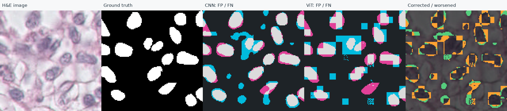

# 남은 네 가지 보완의 진행 상태

사용자가1–4번을 모두 진행하도록 요청한 범위입니다. 기존 C++ 측정·ViT 단일 비교·손실 비교3개 seed 작업의 완료 상태는 유지합니다. 면접 문장 작성은 보류합니다.

| 항목 | 완료한 작업 | 남은 사용자 의존 작업 |
|---|---|---|
| 1. 원본 보관·재현 | 표준 라이브러리만 쓰는 보관·검증 도구, 변조/누락/경로/덮어쓰기 검증, 개발 참고112파일ZIP 실물 검증. 후속 소스1744544의 Ubuntu Docker 빌드·366개 검사·Dice42/6·정적/HTTP 검사 성공 | **[56단계 원본 수신·감사 완료](USER_RESEARCH_AUDIT.md)**. 실제112파일·두 모델SHA·C++72회·ViT60영역 확인; 기존 코드·모델 재실행은 하지 않음 |
| 2. ViT 오류 분석 | 저장 확률·GT60영역 감사, 전체10행과 최대 상승/하락 사례·동일ROI의 FP/FN 그림. 개발 참고 결과 실물 확인 | **사용자09_1/09_6 보고서 생성·수치 대조 완료**. 사용자 직접 화면 검토 여부는 별도 미확인 |
| 3. 직접 모델 변경 | **사용자 LocalResidualHead 본문·13개 테스트 보고 확인**, 실제 ViT 연결과366개 일반 검사 통과. seed20261116의 개발 참고 두 모델 학습·60영역 감사·원본 보존 완료 | [58단계](STEP_58.md) Codespaces 비교 실행·SUMMARY 제출 대기. 개발 참고 학습을 사용자 실행으로 기록하지 않음 |
| 4. 추가 seed | **개발 환경에서3개 seed·총6모델 비교 완료**,180영역 재감사·원본 보존 확인, 전체 원본 ZIP 보관 | 사용자 직접 실행으로 기록하지 않음. 같은 실험을 다시 수행해야 완료되는 조건은 아님 |

## 실제 3개 seed 결과

seed20261113·20261114·20261115. 기존20261113 동결 소스·환경을 재사용했고, 나머지 두 seed를 새로 학습했습니다. 새 실행 순서는 ViT→CNN, CNN→ViT입니다. train33/validation10,16epoch×20step,batch8,crop128,Adam0.001,BCE+사용자 soft Dice,threshold0.35/0.5/0.65를 고정했습니다.

| 평가 영역 | CNN 평균 ± 표본 SD | ViT 평균 ± 표본 SD | 쌍별 ViT−CNN 평균 ± 표본 SD | 상승/동일/하락 |
|---|---:|---:|---:|---|
| 전체 | 0.537512 ± 0.009628 | 0.565899 ± 0.018563 | +0.028387 ± 0.012657 | 3/0/0 |
| 128px 패치 경계 | 0.478700 ± 0.015807 | 0.545517 ± 0.025072 | +0.066817 ± 0.035538 | 3/0/0 |
| 경계 제외 내부 | 0.543597 ± 0.012850 | 0.556910 ± 0.017452 | +0.013313 ± 0.004768 | 3/0/0 |

[전체 요약](../artifacts/experiments/cnn-vit-repeats-20261111/re-audited-summary.json) · [원본·재감사 방법](../artifacts/experiments/cnn-vit-repeats-20261111/README.md).

이 표는 개발 참고 환경(EPYC9V74,논리CPU5,Python3.12.14,torch2.15CPU)의 실험입니다. 사용자의 EPYC7763 Codespaces 단일 실행0.503768→0.557644와 혼합하지 않았습니다. 3개 seed 모두 상승했지만 같은 기존 validation10장·2그룹에서 epoch/threshold를 선택했습니다. 독립 test·외부 데이터·임상 검증, ViT 일반의 우월성으로 확대하지 않습니다. 각 seed가 같은 이미지를 다시 평가한 것이므로30개 독립 검증 이미지로 세지 않습니다.

## 오류 분석에서 실제 확인한 것

[개발 참고 분석 원본](../artifacts/experiments/cnn-vit-error-review-20261111/report.json) · [동일ROI 전체·확대 화면](../artifacts/experiments/cnn-vit-error-review-20261111/index.html). HTML은 저장소에서 내려받아 열거나 로컬 HTTP로 제공해 볼 수 있습니다.

사례는 전체 이미지 Dice(ViT−CNN)의 최댓값·최솟값으로 고릅니다. 확대 영역은128×128,32px 간격과 영상 끝을 포함해 교정−악화 픽셀 수가 해당 방향으로 가장 큰 곳을 선택합니다. 동률은 이미지ID,ROI의y·x 순으로 결정합니다. 전부 사후 설명용 사례이며 대표 성능의 별도 추정치가 아닙니다.

- 개발 참고 `09_4`: 전체 Dice차이−0.059020. 선택ROI `(320,224)–(448,352)`의 FP1230→1430, FN637→1077, Dice0.755724→0.661354. 이 ROI에서는 두 종류의 픽셀 오류가 모두 늘었습니다. 확대된 ViT 예측에서 각진 블록 형태가 관찰됩니다. 이것만으로 토큰화가 원인이라고 확정하지 않습니다.
- 개발 참고 `09_1`: 전체 Dice차이+0.087378. ROI `(384,192)–(512,320)`의 FN3183→2479, FP201→308, Dice0.183398→0.437538. FN 감소와 FP 증가가 함께 나타났습니다.
- 사용자 `09_1`은 반대로 전체 Dice가 하락했습니다. 따라서 위 그림을 사용자 실험의 그림으로 대체하지 않습니다. 후속 [사용자 원본 보고서](USER_RESEARCH_AUDIT.md)에서09_1·09_6를 독립적으로 다시 계산했습니다.

청록은FP,분홍은FN,회색은일치한 전경,변화 지도 초록은교정·주황은악화입니다. 수치는 핵 개수가 아닌 픽셀입니다. 원본PNG 좌표와 동일한 ROI를 사용하고, 확대는 최근접 보간으로 표시합니다.

## 직접 모델 변경의 범위

한 구성요소만 변경하고 같은 학습·선택 조건에서 기준 모델과 비교합니다. 예를 들어 경계 형태의 국소 불연속이 실제 사용자 사례에서도 관찰된다면 작은 공간 보정 head가 후보가 될 수 있습니다. 원본 수신 후 [57단계](STEP_57.md)의 작은 공간 잔차 보정을 시험할 가설로 선택했습니다. 이후 사용자 본문을 받아 그대로 반영했고 별도13개 계약 검사와 실제 ViT 연결을 검증했습니다. 개발 참고 비교에서는 전체 Dice가 상승했지만 경계 Dice는 하락했습니다. 오류 원인을 확인하지 않고 성능이 좋아지는 구조라고 단정하지 않으며, 결과가 나빠져도 그대로 보존합니다. 전체 모델 재작성·추가 대규모 데이터 작업은 이 네 보완의 필수 범위가 아닙니다.

## 실행·보존 근거

검사·Docker 실행 근거는 [검증 기록](../artifacts/experiments/final-followup-checks/summary.json)에 정리합니다. 기존 공개 모델·실험·데모 파일의 해시는 변경하지 않습니다. 사용자 원본 도구는 고정 커밋a63c499로 다운로드하므로 로컬 저장소 pull/reset이나 작성한 함수의 덮어쓰기가 없습니다. ZIP의 SHA 검증과 저장 확률에서 지표를 재계산하는 과학적 감사를 구분합니다.

Docker는 [실행43019941310](https://github.com/sokldjs554/pathology-edge/actions/runs/43019941310)의소스 `033720d`를 검증했습니다. [20개 원본 로그](../artifacts/reproductions/docker-033720d/evidence.zip)와 소스manifest를 내려받아 저장소 파일 해시를 다시 대조했습니다. 이후 변경은 실행 증빙·문서 기록이며, 검증된 코드 해시는검증JSON에 있습니다. Docker 검사 안에서 데이터셋 학습·평가는 실행하지 않았고, 별도 개발 참고 추가4회 학습과 구분합니다.

2026-11-12 후속: 사용자 원본 수신·감사와359개 일반 테스트를 완료했습니다.13개 사용자 실습 검사는 별도이며 사용자 실행 완료로 기록하지 않았습니다. [검증·대기 범위](../artifacts/learning/step57-preparation.json). 이전 Docker033720d의331개 검증과 이번 모듈 준비 소스를 구분합니다.

이번 준비 소스 `f90220d`의 [원격 CPU 검사](https://github.com/sokldjs554/pathology-edge/actions/runs/43059841269)는 성공했습니다. [Docker 재현](https://github.com/sokldjs554/pathology-edge/actions/runs/43059842027)은 두 번 모두 Ubuntu 패키지 서버의 DNS 조회 실패로 빌드 단계에서 중단됐습니다. 따라서 이번 소스의 컨테이너 내부 검사는 미실행이며 이전 성공으로 대체하지 않습니다. [실패 원본 로그·소스 해시 대조](../artifacts/reproductions/docker-f90220d/review.json)를 보관했습니다. Docker 설정을 임의로 바꾸거나 새 실험을 실행하지 않았습니다.

## 제출 모듈을 연결한 후속 비교

[원본·조건·전체 이미지별 결과](../artifacts/experiments/vit-refinement-reference-20261112/README.md). seed20261116 개발 참고 환경에서 전체 Dice0.570565→0.583877, 경계0.558802→0.550175, 내부0.560474→0.576742였습니다. 전체 점수가 좋아져도 모든 영역이 개선된 것은 아닙니다. 동일 초기 ViT·crop/증강 순서를 감사했고 새 모델2개·60평가 영역·원본/실습 파일 보존을 확인했습니다. 사용자 실제 학습은 별도 대기이며 [58단계](STEP_58.md) 하나만 안내합니다. [코드 수신·검증 근거](../artifacts/learning/step57-accepted-review.json).

Docker 후속: 제출 코드를 연결한 소스 `1744544`의 [실행43070288195](https://github.com/sokldjs554/pathology-edge/actions/runs/43070288195)는 빌드·컨테이너366개/skip0·Dice42/6·정적/HTTP 검사에 성공했습니다. [원본 로그와 소스 해시 대조](../artifacts/reproductions/docker-1744544/review.json)를 보관했습니다. 이전 f90220d의 DNS 실패를 성공으로 고치지 않고 새 소스의 성공을 별도 기록합니다. Docker 내부 데이터셋 학습·브라우저 검증은 미수행이며 개발 참고 두 모델 학습과 구분합니다.
