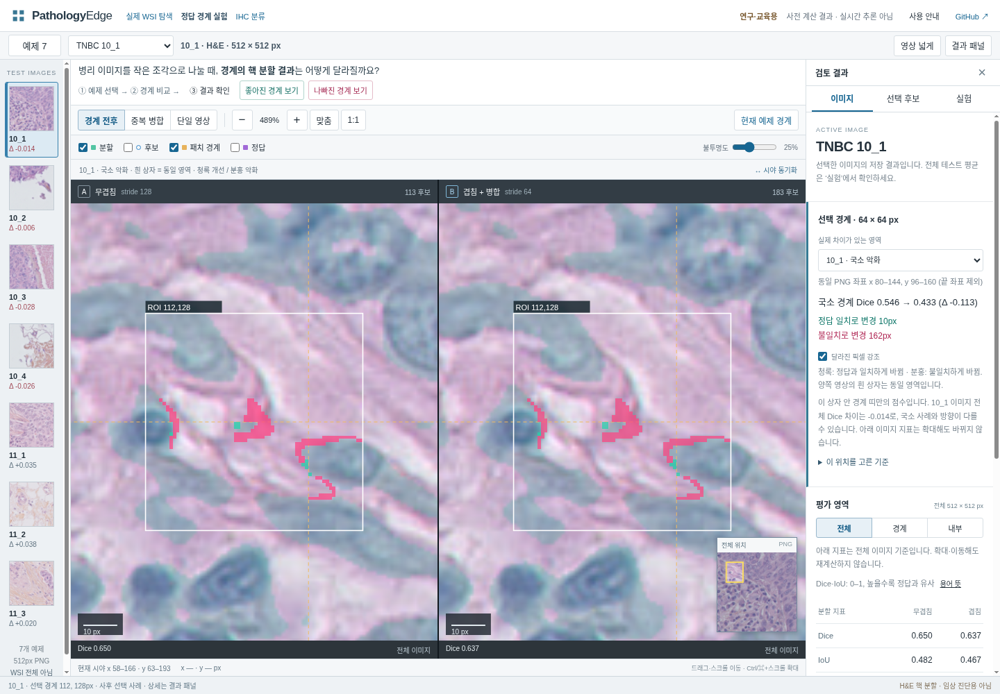

# 13단계: 데모에서 실제 악화 경계 하나 확인

상태: **사용자 화면 확인 대기**. 12단계에서 저장 이미지 해시50개·분할 간 해시 중복 없음 출력을 확인했습니다. 이번에는 터미널 명령이나 새 코드 없이 데모의 화면 한 흐름만 확인합니다.

## 직접 확인할 순서

1. 데스크톱 브라우저에서 [정답 경계 실험 데모](https://pathology-edge-lab.ykh13571.chatgpt.site/)를 엽니다.
2. 예제 선택에서 **TNBC 10_1**을 선택하고 **현재 예제 경계**를 누릅니다. ‘나빠진 경계 보기’는 다른 예제를 열 수 있으므로 이번에는 현재 예제 버튼을 사용합니다.
3. 양쪽 영상의 흰 상자와 오른쪽 **선택 경계 · 64 × 64 px** 내용을 확인합니다. 패널이 닫혀 있으면 상단 **결과 패널**을 누릅니다.

## 예상 화면

- 양쪽 영상이 같은 위치로 확대되고 흰 상자가 같은 조직 영역을 표시합니다. 상자 중심은 PNG 좌표 **(112,128)**입니다.
- **국소 경계 Dice: 0.546 → 0.433 (Δ −0.113)**.
- **정답 일치로 변경10px / 불일치로 변경162px**. 청록은 정답 일치로 바뀐 픽셀, 분홍은 불일치로 바뀐 픽셀입니다.

이 점수는 선택한64×64 상자와 경계 띠가 겹치는 작은 영역의 값입니다. 아래 ‘평가 영역’ 표의 이미지 단위 점수나7장 평균과 구분합니다. 이미 저장된 모델 결과를 검토하는 화면이며 버튼을 눌러 새 추론을 실행하는 것은 아닙니다.

**실제로 보이는 국소 Dice 두 값과, 양쪽 흰 상자가 같은 위치를 보여 주는지**를 보내 주세요. 예: `국소 Dice A→B / 같은 위치로 보임`처럼 확인한 사실만 적으면 됩니다. 화면이 다르거나 열리지 않으면 해당 상태와 브라우저 이름을 알려 주세요. 이번에는 추가 예제·이동 조작·다른 탭까지 검사할 필요가 없습니다.

## Codex 확인 범위

2026-11-09 현재 실행 환경의 공개 URL HTTP 조회는403(`error code: 1010`)을 반환했습니다. 이번 턴에 공개 배포 화면을 브라우저로 재확인했다고 기록하지 않았습니다.

저장소 `dist/`를 로컬 서버로 열어 Chromium에서 초기 예제10_1과 버튼 동작, 양쪽 같은 사례·중심 좌표, 국소 Dice·픽셀 수의 `dist/cases.json` 일치를 확인했습니다. 화면 캡처도 확인했습니다. 원본 UI·모델·결과 파일은 변경하지 않았습니다.

[로컬 검증 기록](../artifacts/learning/step13-preparation.json) · [기여 기록](CONTRIBUTIONS.md)

사용자가 위 흐름을 확인하기 전에는 화면 테스트 완료로 기록하지 않습니다. 기존의 전체 UI 검토 항목 U06과 이동 확인 항목은 별도로 남아 있으며, 이번 한 사례만으로 모두 완료 처리하지 않습니다.
