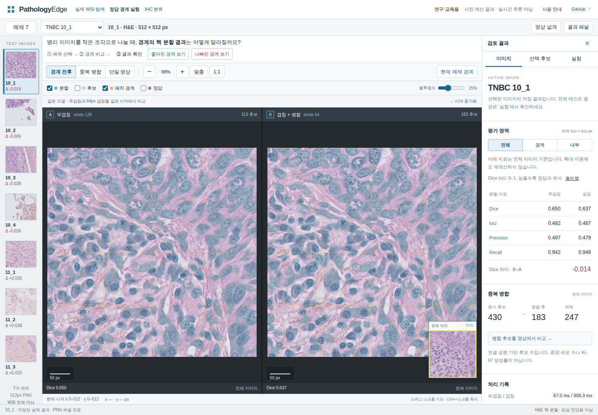
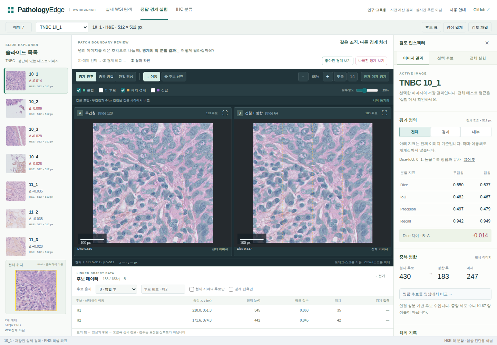

# Linked pathology workbench · 2026-11-16

## What changed

The boundary-review page now combines a slide browser, synchronized medical-style panes, and linked candidate inspection. The earlier narrow thumbnail strip is replaced by readable slide rows and a persistent overview. A candidate table beneath the viewer links saved source indexes to both image location and a source-image crop in the inspector. Each pane can be enlarged and restored. Pan and candidate selection are explicit tools.

On smaller or shorter screens the table starts collapsed. Its toggle remains available, and the work column can scroll when the open table cannot fit vertically. The existing mobile A/B switch remains available. WSI and IHC routes retain their prior UI and functions.

The change uses the existing HTML/JavaScript canvas viewer and adds no production dependencies. It does not run inference, modify experimental results, or alter user-authored Python algorithms.

## References and design decisions

- [QuPath viewer](https://qupath.readthedocs.io/en/stable/docs/starting/viewing.html): large image, slide navigation and location overview.
- [OHIF viewer](https://docs.ohif.org/user-guide/viewer/): separate image panes and inspectable results, with explicit active view controls.
- [HALO object data](https://indicalab.com/news/halo-halo-ai-and-halo-link-4-1-features-and-functionalities/): selection links between object data and spatial context.
- [napari viewer](https://napari.org/stable/getting_started/viewer.html): consistent overlay visibility controls.

The design combines these interaction patterns; it does not reproduce a vendor screen or claim its clinical functionality.

## Inspect the new version

1. Select a TNBC example in the left slide list. Its saved image and metrics update together.
2. Open a better or worse boundary. A and B show the same selected region; the inspector gives the stored local evidence.
3. Use the corner button on A or B to enlarge that pane, then restore comparison.
4. Open **후보 표**, enter `#12`, and select its row. Both views move to that candidate's saved coordinates; the right inspector shows its source crop and fields.
5. Switch the table source between A and B, or filter to the current view / patch-edge contact. Candidate numbering always refers to the selected source list.
6. Open **중복 병합** and a stored suppression pair. Raw/retained identities remain available. A suppression link does not establish that the two predictions are the same real nucleus.
7. On a small screen, use the A/B switch and the example/results/table buttons. Close the inspector to return to the image.

## Verification scope

The local managed browser control is unavailable in this session. Browser verification therefore uses the repository's existing GitHub Actions Playwright workflow in Chromium and WebKit, not a claim of local hands-on browser testing.

Initial browser checks identified obsolete fixed-width/border assumptions and native-pixel interpolation with fractional canvas sizes. Geometry checks now account for pane borders and compare single-view size to the available paired view. Logical rendering dimensions match backing pixel dimensions; native and enlarged images use nearest-pixel sampling. An independent static review identified short-screen clipping, covered by a new small-height dock test.

The first local Python run was affected by sparse-checkout fixture omissions and exhausted temporary disk space. After restoring immutable fixtures and cleaning only task-generated temporary files, 460 tests passed; two disk-guard tests could not reach their intended scenario because the local filesystem had less than 2 GiB free. The GitHub runner passed all 462 Python tests and the 42 individual / 6 mean saved-Dice checks on the final code/test commit `f823bac1c747406c7999ccf6390a6fdf7ac86197`.

## Screenshots

| Previous workbench | New slide/compare workbench |
| --- | --- |
|  |  |

[Linked candidate selection](../artifacts/ui-linked-workbench-20261116/after-selection.png) · [Small screen](../artifacts/ui-linked-workbench-20261116/after-mobile.png)

The before image is the previously captured production-v7 Chromium image, not a new capture of the old deployment. The after images are actual Chromium captures of deployed production version 8 from [workflow 43731956593](https://github.com/sokldjs554/pathology-edge/actions/runs/43731956593), including native source images and saved outputs.

User verification of this new interface is pending; previous-version user checks are not transferred to this version.

## Code verification and publication

| Check | Result | Evidence |
| --- | --- | --- |
| Python suite on GitHub Ubuntu | 462 passed | [CPU checks](https://github.com/sokldjs554/pathology-edge/actions/runs/43731542536) |
| Saved Dice audit | 42 individual values and 6 means matched | Same CPU run |
| Node data / viewer geometry | 14 passed | Browser workflow |
| Chromium, checkout | 51 passed, no skips or retries | [UI workflow](https://github.com/sokldjs554/pathology-edge/actions/runs/43731542454) |
| WebKit, checkout | 51 passed, no skips or retries | Same UI workflow |
| Chromium + WebKit, deployed version 8 | 51 passed each, no skips or retries | [Production UI workflow](https://github.com/sokldjs554/pathology-edge/actions/runs/43731956593) |
| Existing experiment / image / unchanged route files | 2,185 files unchanged from main | Byte comparison against `ced2a3b` |

The public [demo](https://pathology-edge-lab.ykh13571.chatgpt.site/) is published as Sites version **8**. The GitHub code/test commit is `f823bac1c747406c7999ccf6390a6fdf7ac86197`; the Sites source mirror commit is `659fb0eb24f244f298380f5fe6428dd1a8cb4a39`. They use different repository histories. All **2,191** deployed `dist/` files match that code commit; the [complete deployed-byte report](../artifacts/ui-linked-workbench-20261116/deployment-parity.json) records the comparison. Only the explicitly fingerprinted hosting challenge script is normalized from HTML. Subsequent documentation-only commits do not change the deployed assets.

[Verification metadata](../artifacts/ui-linked-workbench-20261116/verification.json) · [Unchanged image/result asset hashes](../artifacts/ui-linked-workbench-20261116/unchanged-assets.json)
