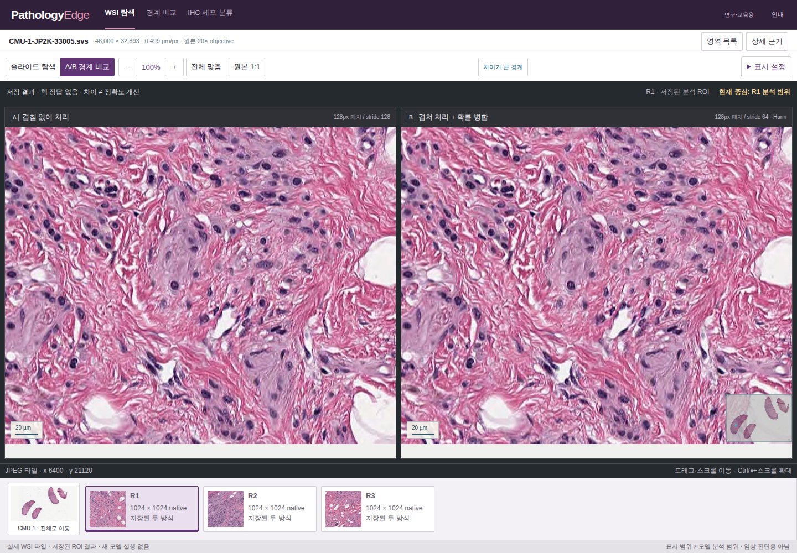
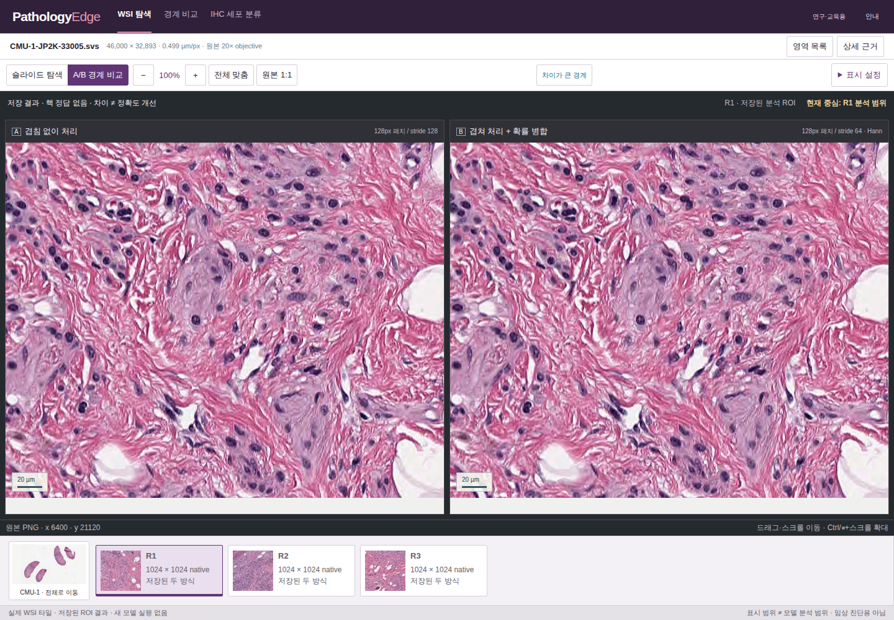

# WSI 원본 화질 표시

후속 변경: [64×64 경계 확대 보기](UI_WSI_BOUNDARY_ZOOM.md). ‘차이가 큰 경계’만 최대 300%로 표시하며, 일반 ROI 이동은 100% 이내입니다. 아래 내용·캡처·검증 수치는 버전26 기록입니다.

R1–R3의 분석 입력 RGB PNG를 기존 level-0 위치에 표시합니다. 전체 슬라이드 배경은 기존 JPEG Q75 타일이며, PNG는 세 분석 영역에만 적용합니다. 세 PNG를 보관된 SVS에서 같은 좌표로 읽은 RGB 및 저장된 해시와 대조했고 모두 일치했습니다. 새 디테일을 생성하거나 샤프닝하지 않았고, 모델·예측·평가·주석은 그대로입니다.

## 바뀐 조작

- **원본 1:1**을 기본 확대 도구로 옮겼습니다. 원본 1픽셀을 화면 1 CSS 픽셀로 보여줍니다. 고밀도 화면에서도 같은 정의입니다.
- ROI·경계·중복 후보로 자동 이동할 때 중심은 유지하고 100% 이내로 시작합니다. 사용자가 + 또는 Ctrl/⌘+스크롤로 더 확대할 수 있으며, 이때 하단에 **확대 표시**가 나옵니다.
- **표시 설정 → 원본 ROI 화질**은 기본으로 켜져 있습니다. 끄면 같은 위치·배율의 기존 JPEG 타일과 비교할 수 있습니다. 예측 불투명도와 독립된 기능입니다.
- 하단에는 현재 중심이 **원본 PNG / JPEG 타일** 중 무엇으로 표시되는지 나옵니다. PNG를 읽지 못하거나 치수가 맞지 않으면 JPEG 타일을 유지하고 안내·재시도를 제공합니다. 느린 PNG 요청은 전체 슬라이드 탐색을 막지 않습니다.

## 직접 확인

1. [WSI 탐색](https://pathology-edge-lab.ykh13571.chatgpt.site/wsi.html)에서 R1을 선택합니다.
2. ‘차이가 큰 경계’를 누르면 양쪽이 같은 저장 좌표에 도착하고, 확대율은 100% 이하입니다.
3. ‘원본 1:1’을 누르고 ‘표시 설정’에서 핵 예측·경계를 끈 뒤, ‘원본 ROI 화질’을 껐다 켭니다. 같은 조직을 JPEG 타일과 원본 PNG로 비교합니다.
4. 예측을 다시 켭니다. 원본 화질 선택을 바꿔도 마스크·좌표·점수는 바뀌지 않습니다.
5. +로 확대하면 ‘확대 표시’가 나오며, ‘원본 1:1’로 돌아가도 중심은 유지됩니다.

사용자가 이번 변경을 확인했다는 기록은 아직 없습니다.

## 해석 범위

이 개선은 이미 있는 원본 정보를 표시하는 방법의 개선입니다. 스캔 원본은 20×, 약 0.499 µm/px이며, 저장되지 않은 광학 디테일은 생기지 않습니다. 핵 정답이 없는 WSI이므로 선명도나 예측 차이를 모델 정확도 향상으로 해석할 수 없습니다. IHC의 224×224 원영상·48×48 확대 조각에는 변경을 적용하지 않았습니다.

[원본 픽셀 대조](../artifacts/ui-wsi-native/source-pixel-proof.json) · [파일 동일성](../artifacts/ui-wsi-native/source-identity.json) · [JPEG 재압축 차이 표본](../artifacts/ui-wsi-native/jpeg-compression-samples.json)

JPEG 차이는 각 ROI의 명시된 64×64 원본 위치에서 RGB 값의 평균 절대 차이를 계산한 것이며, 세포 검출/분할 성능 지표가 아닙니다. R2 표본은 JPEG 타일 경계를 피하도록 중심에서 조금 이동한 위치입니다.

## 화면 비교

아래 두 화면은 동일한 R1 위치·100% 배율에서 예측 표시를 끄고, ‘원본 ROI 화질’만 전환한 비교입니다. 이전 배포 화면을 재현한 이미지가 아니라 같은 버전의 두 표시 경로를 실제 브라우저에서 캡처한 것입니다.

| 기존 JPEG 타일 표시 | 원본 PNG 표시 |
| --- | --- |
|  |  |

[경계·예측을 함께 표시한 데스크톱](../artifacts/ui-wsi-native/wsi-native-boundary-1440.png) · [375px 화면](../artifacts/ui-wsi-native/wsi-native-boundary-375.png) · [1024px·DPR 2 화면](../artifacts/ui-wsi-native/wsi-native-retina.png)

## 검증 범위

- PNG 세 장과 보관된 SVS의 동일 좌표 RGB를 픽셀 단위로 대조했습니다.
- 두 영상의 원본 좌표, 자동 이동 중심, 1:1 복귀, 창 크기·패널 변경 후 중심/배율 유지, 예측 불투명도와 원본 표시의 독립성을 검사했습니다.
- PNG 404·잘못된 치수·응답 지연 상황에서 JPEG와 예측이 남고 재시도로 PNG가 복구되는지 검사했습니다.
- 데스크톱·모바일·고밀도 화면, 기존 TNBC/IHC 흐름을 회귀 검사에 포함했습니다.
- 런타임 수정은 WSI JS/HTML과 WSI 범위 CSS뿐입니다. [영상·마스크·결과·모델 보존 대조](../artifacts/ui-wsi-native/asset-preservation.json).

검사 도중 발견한 창 크기 변경의 이중 배율 적용을 제거했습니다. Chromium의 반 픽셀 도구줄 높이는 정수 줄 높이로 정리했습니다. 원본 좌표를 임의로 옮기거나 픽셀 비교의 허용 오차를 늘리지는 않았습니다.

## 버전과 실행 근거

- 공개 배포: **버전26**, [WSI 탐색](https://pathology-edge-lab.ykh13571.chatgpt.site/wsi.html).
- UI 코드: [`a1d5de4`](https://github.com/sokldjs554/pathology-edge/commit/a1d5de47d496abab1c83a0bbbab2eb66a4aa16de). 공개 Site 소스: `bc27b78372b6589e4e944f61a00fe424c097c869`.
- 두 저장소의 배포 파일 **2,197개가 동일**합니다. 공개 주소에서도 변경 파일·기존 TNBC/IHC 코드·세 PNG 등 11개를 내려받아 SHA-256을 대조했습니다. [대조 기록](../artifacts/ui-wsi-native/public-parity.json).
- [소스 브라우저 실행](https://github.com/sokldjs554/pathology-edge/actions/runs/43874026047): Chromium **88/88**, WebKit **88/88**, 실패·skip·flaky 0개. [Chromium 원본 보고서](../artifacts/ui-wsi-native/source-chromium-report.json) · [WebKit 원본 보고서](../artifacts/ui-wsi-native/source-webkit-report.json).
- [CPU CI](https://github.com/sokldjs554/pathology-edge/actions/runs/43874042267): Python **462개 통과**, 저장 Dice **42/42**, 평균 **6/6** 일치. Node **19개 통과**. [CPU 로그 요약](../artifacts/ui-wsi-native/cpu-ci-summary.log) · [Node 로그](../artifacts/ui-wsi-native/node-tests.log).
- 1440px·DPR 1의 R1 중앙 64×64 화면 표본에서, 동일 화면 변환으로 그린 원본 RGB와 PNG 표시의 RGB 평균 절대 차이는 **0**, JPEG 표시의 차이는 **3.3613**였습니다. 화면 표본 대조이며 전체 WSI 화질 지표나 모델 성능 지표가 아닙니다. [화면 픽셀 대조](../artifacts/ui-wsi-native/wsi-native-pixel-check.json).

CI의 실제 Chromium·WebKit에서 자동 조작하고 캡처를 검토했습니다. 로컬 데스크톱에서 수동 브라우저 검사를 했다는 의미는 아닙니다. 공개 배포 주소에서도 같은 전체 검사를 실행했습니다.

- [공개 데모 재검사](https://github.com/sokldjs554/pathology-edge/actions/runs/43875223710): Chromium **88/88**, WebKit **88/88**, 실패·skip·flaky 0개. [Chromium 보고서](../artifacts/ui-wsi-native/public-chromium-report.json) · [WebKit 보고서](../artifacts/ui-wsi-native/public-webkit-report.json).
- 위 화면 캡처와 화면 픽셀 대조 JSON은 공개 배포 버전26의 Chromium 실행에서 수집했습니다. [전체 검증 요약](../artifacts/ui-wsi-native/verification.json).
- 코드와 근거는 UI 브랜치/[Draft PR #3](https://github.com/sokldjs554/pathology-edge/pull/3)에 있으며, main 병합과 사용자의 직접 확인은 별개입니다.
