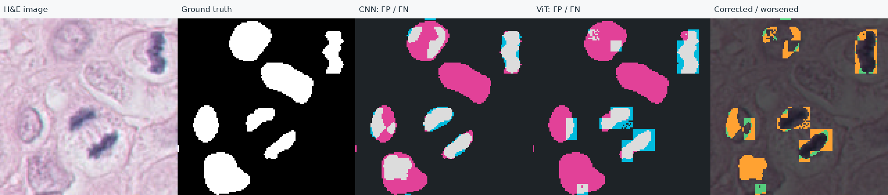
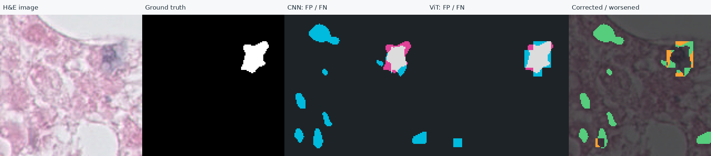

# 사용자 C++·CNN/ViT 원본 감사

수신·검토일: **2026-11-12 (Asia/Seoul)**. [수신 원본 ZIP](../artifacts/learning/step56-user-evidence/research-evidence.zip) · [감사 기록](../artifacts/learning/step56-user-evidence/review.json) · [모델별 전체 수치](../artifacts/learning/step56-user-evidence/vit-re-audit.json).

## 대조 결과

- 실험 파일112개(별도manifest를 포함하면ZIP113항목)의 무결성·필수 파일·원본 보존 기록을 확인했습니다. 원래 체크아웃과 별도 학습 체크아웃의 전후 기록도 각각 일치합니다. 사용자 제출 ZIP을 보관했으며, 새로 생성한 실험을 사용자 결과로 대체하지 않았습니다.
- 두 모델SHA는 이전 제출값과 정확히 일치합니다. ViT 실행에 보관된Python 소스19개도 고정 커밋917038f의 파일과 모두 일치합니다. 첨부된 코드나C++바이너리는 실행하지 않았습니다.
- C++8조건×9회=72개 원시 시간을 받아 중앙값·Python대비 배율·peak RSS를 대조했습니다. 이전 표의24개 표시값은 반올림 범위에서 모두 일치합니다. 새 벤치마크를 실행한 것은 아닙니다.
- 저장 확률과 TNBC 정답에서10장×2모델×3영역=60개 지표 묶음을 다시 계산했습니다. 기존 모델별 요약과 일치하고, 이미지별30개 표시값도6자리 반올림에서 모두 일치합니다.7개 상승·0개 동일·3개 하락입니다.

새 학습·모델 추론·test 평가는 하지 않았습니다. 원본 제출·독립 감사 완료와 사용자의 화면 검토·다음 코드 작성은 구분합니다.

## 실제 사용자 오류 사례

사례는 전체 이미지 Dice차이의 최댓값·최솟값으로 선택했습니다. 확대ROI는128×128,32px 간격+영상 끝 중 교정−악화 픽셀 수가 해당 방향으로 가장 큰 영역입니다. 좌표는 원본PNG의xyxy이며 끝 좌표를 제외합니다. 전체10행을 유지해 좋은 사례만 골라 보고하지 않았습니다.

| 이미지 | 전체 CNN Dice → ViT Dice | 전체 FP 변화 | 전체 FN 변화 |
|---|---:|---:|---:|
| 09_1 · 최대 하락 | 0.402373 → 0.344220 | 3,292 → 2,975 | 28,445 → 30,376 |
| 09_6 · 최대 상승 | 0.365310 → 0.651067 | 1,305 → 639 | 488 → 211 |

**09_1 전체에서는FP가 줄었지만 FN이 더 늘었습니다.**128px 타일 경계 Dice는0.137708→0.224948로 상승했고, 경계 제외 내부는0.447535→0.367258로 하락했습니다. 전체 점수 하락을 모든 위치·모든 지표의 하락으로 설명할 수 없습니다.

선택ROI `(160,128)–(288,256)`에서는FP164→509,FN1,848→2,361로 둘 다 늘었고 Dice0.587536→0.390658입니다. 교정210px·악화1,068px입니다. 전체와ROI의FP 변화 방향이 다른 것은 평가 범위가 다르기 때문입니다.

**09_6 전체에서는FP와FN이 모두 줄었습니다.**선택ROI `(288,384)–(416,512)`는FP859→228,FN164→49,Dice0.367347→0.748411입니다. 교정904px·악화158px이며, 좋아진 이미지에도 악화된 픽셀은 존재합니다.

그림은 왼쪽부터H&E·정답·CNN오류·ViT오류·변화 지도입니다. 청록=FP,분홍=FN,회색=일치한 전경. 변화 지도 초록=교정,주황=악화. 색과 수치는 픽셀 단위이며 핵 개수를 뜻하지 않습니다.

[전체 이미지와 동일위치 확대 HTML](../artifacts/experiments/user-cnn-vit-errors-20261112/index.html) · [전체10행·세영역·ROI 좌표·파일SHA](../artifacts/experiments/user-cnn-vit-errors-20261112/report.json). HTML은 그림 파일들과 함께 내려받아 열거나 로컬HTTP서버로 제공할 수 있습니다.

## 해석과 다음 실험

사용자09_1·09_6의 확대 예측에는 각진 국소 조각이 관찰됩니다. 그러나 토큰화가 원인이라고 확인한 것은 아니며, 특히09_1의 많은FN을 작은 공간 보정만으로 모두 복구한다고 기대하지 않습니다. **이웃 logits를 함께 사용하는 작은 보정 head의 효과**를 하나의 가설로 시험합니다. 이를 [57단계](STEP_57.md)의 직접 작성 모듈로 연결합니다.

이 비교는 기존validation10장·2그룹에서epoch/threshold를 선택했습니다. 선택 사례는 사후 설명용이며 임상적 오류 원인이나 대표 빈도의 증거가 아닙니다. 개발 참고 실행의09_1 상승 사례와 사용자 실행의09_1 하락 사례를 섞지 않습니다. 사용자 직접 영상 검토는 아직 완료로 기록하지 않았습니다. 후속 57단계의 모듈 본문과13개 테스트 통과 보고는 받아 확인했으며, [58단계](STEP_58.md) 실제 사용자 비교 학습·검산·보존 성공 보고도 받았습니다. 이번 보정 비교의 원본 수신·독립 감사는 [59단계](STEP_59.md)에서 별도로 진행합니다.
