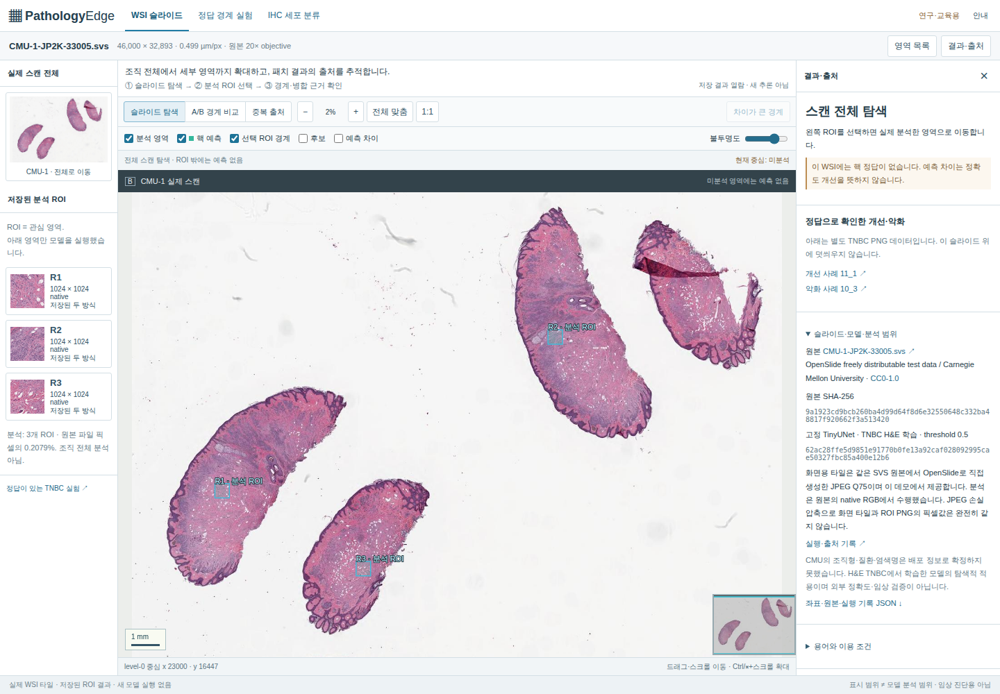
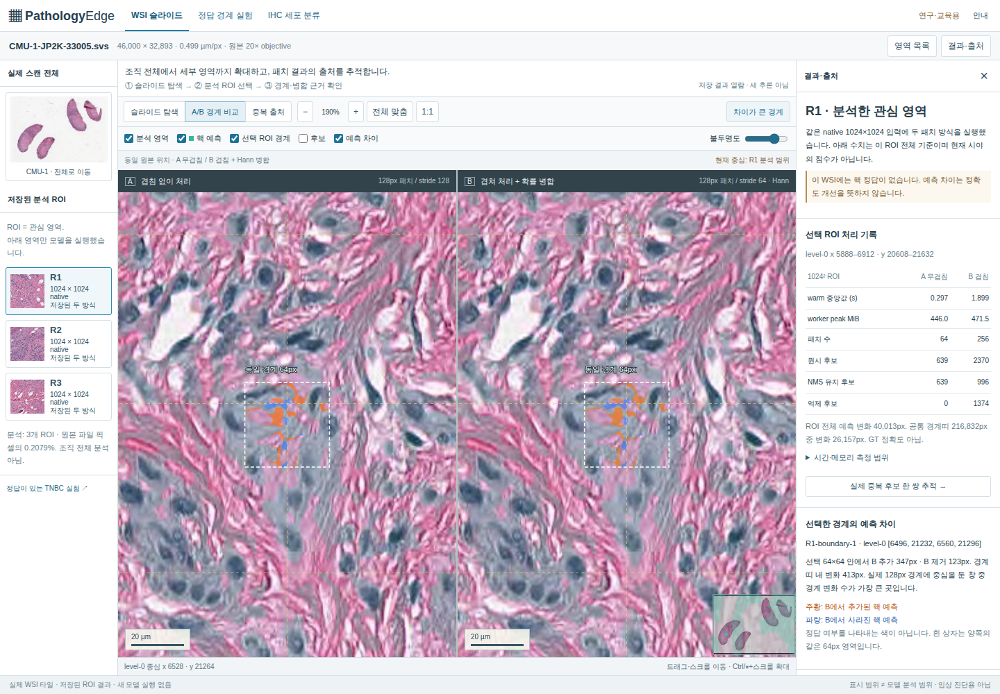

# WSI·IHC 확장 보고와 직접 확인 순서

2026-11-08 Asia/Seoul. Codex 수행 기록이며 사용자 실행 기록과 구분한다.

## 출발 상태와 보존

시작 시 `main`은 `40f18fc55052912bc3fcf9fa3342c9ebb1f54cea`, 작업 파일 변경은 없었다. 원본 checkout은 보존하고 별도 `feature/wsi-review` worktree에서 작업했다. 기존 공개 버전5는 UI `9278071`, Sites source `21855b4`였고, 문서 후속 main과 `dist/`49파일이 같았다. 실제 배포 파일을 내려받아 비교하고, 변경 전 공개 URL에서 Chromium·WebKit 각26개 검사를 다시 실행했다([run42458270539](https://github.com/sokldjs554/pathology-edge/actions/runs/42458270539)).

기존 모델·결과·경계 사례·42개 PNG·사용자 함수 **46개 파일의 바이트 불변**을 확인했다. [보존 근거](../artifacts/ui/wsi/invariants.json), [배포 전 파일 대조](../artifacts/ui/wsi/baseline-files.json). v5의 국소 사례는 `dist/cases.json`, 원 점수는 `dist/results.json`, 생성·검사는 `review_cases.py`/`test_review_cases.py`에 있다. 새 WSI 결과와 섞지 않았다.

## 조사 → 선택

[프로젝트·논문 비교](WSI_LANDSCAPE.md)에 KatherLab, TIAViz, QuPath, DSA, caMicroscope, EOV, TissUUmaps, Slideflow, PathoQuant, hd_wsi, CellViT, HoVer-NeXt, Hann 논문, tiler, Vooban, ASHLAR와 추가 소규모 코드 사례의 목적·데이터·모델·평가·한계를 기록했다. [회사·IHC 조사](AIVIS_IHC_FEASIBILITY.md)는 IHCScoreGAN, NuCLS, BCData, PathoNet, Patherea도 비교한다. 타사 모델은 실행하지 않았으며, 문서·소스 관찰과 이번 프로젝트의 실제 실험을 구분한다. 일부 공개 데모는 환경의 CA 문제로 렌더링을 확인하지 못했다.

WSI 확대, linked panes, Hann 겹침, 경계 Dice, patch provenance는 이미 선행 기능이다. 기존 PathologyEdge에는 원본 WSI·MPP·실제 원점과 IHC 클래스 평가가 부족했다. 새롭게 발명한 방법이라고 주장하지 않고, **작은 고정 CPU 모델에서 위치·경계 차이·후보 억제 사유·실패·비용을 한 흐름으로 재확인할 수 있는 구현**을 목표로 삼았다.

- KatherLab의 슬라이드 목록·native metadata·물리 눈금: 원본에서 시작하는 탐색에 적용했다.
- QuPath의 이미지↔객체↔측정 연결, TIAViz/TissUUmaps의 layer 구분: 예측 mask, 후보 box, 원 patch, 차이 픽셀을 별개로 켜고 끈다.
- DSA·EOV의 동기화 검토와 provenance: 동일 원본 좌표의 A/B와 입력 SHA·모델 SHA·원 patch 위치를 연결한다.
- Slideflow의 원본 위치와 모델 입력 범위 구분: 슬라이드 탐색 범위와 실제 분석 ROI를 분리한다.
- Pielawski/Wählby의 Hann 경계 연구: 방법의 선행성과 성능/일관성의 차이를 명시하고 정답이 없는 WSI에는 Dice를 만들지 않는다.

에이비스의 QantiIHC·Discovery 및 별도 공식 채용 자료는 WSI 처리·patching·분류/분할/검출·평가·재현성의 연결 근거다. 지정 사람인 공고 원문은 접근하지 못했고, 병역일터 자료를 동일 공고로 단정하지 않았다. 제품을 복제하거나 제품의 임상 검증을 빌려오지 않았다.

## 실제 WSI와 구현

[원본 CMU-1-JP2K-33005.svs](https://openslide.cs.cmu.edu/download/openslide-testdata/Aperio/CMU-1-JP2K-33005.svs), CC0,132,565,343bytes,46,000×32,893,0.499µm/px,원본 objective20×. 전체 파일을 받아 SHA와 OpenSlide 메타데이터를 확인했다. 제공 파일의 스캔 전체를 보여 주며 환자 전체 조직의 완전성을 주장하지 않는다. 정확한 조직형·염색·질환은 공개 설명에서 확정하지 못했다.

OpenSlide4.0.1/LGPL-2.1로 원본 ROI와 전체 DeepZoom 타일을 생성하고, OpenSeadragon6.1.1/BSD-3-Clause로 표시한다. 원본 전체17레벨·2,071타일은 최고46,000×32,893을 유지하며 같은 사이트에서 제공한다. 저장 용량은139,369,111bytes(132.91MiB), 생성71.13초, 생성 프로세스 peakRSS944.23MiB였다. 이 값은 모델 추론 시간이나 브라우저 메모리가 아니다. 하위레벨18타일의1px반올림 차이만 보정했고 native레벨의 리사이즈는0개다. TIAToolbox를 포함한 도구·자료 비교는 [WSI_DATA_OPTIONS](WSI_DATA_OPTIONS.md)에 있다. 로딩 실패·재시도를 구현했으며 새 유료 서비스·GPU를 사용하지 않았다.

R1(5888,20608),R2(29440,9728),R3(15872,26112)의 native1024²만 추론했다. 원본 파일 픽셀의0.2079%이며 조직 면적 비율이 아니다. GT 없음. 원 모델/threshold를 고정하고 ROI는 추론 전 선택했다. 실제 두 출력의 XOR로 선택한64²창을 양쪽에 표시하며, 창 중심은 실제128px패치 경계를 지난다. 선택 규칙은 경계 변화 수→전체 변화 수 내림차순→y/x오름차순이다. ‘좋아진/나빠진’ 표시는 별도 정답 TNBC 화면으로 연결한다.

중복 출처에서는 같은 overlap 분기의 raw→kept를 보여 준다. 번호는 raw index+1이고 원 patch ID·native 원점·상자·IoU·거리·우선순위를 저장 결과에서 읽는다. 픽셀 mask의 확률 병합과 연결 성분 NMS는 별개 분기이므로 NMS 화면의 mask 자체는 동일하다. 억제 쌍을 실제 같은 세포라고 판정하지 않는다.

자체 확대 타일과 native 입력을 3ROI×3지점에서 대조했다. JPEG 손실압축으로 RGB MAE평균3.786/255(범위2.997–4.702)였으며, 모든 지점에서 1px/16px 이동 대조보다 오차가 작았다. 좌표 정렬 근거이지 픽셀 동일성 주장은 아니다. 2,071타일의 크기·hash와 native 가장자리도 검사했다. [최종 실측](../artifacts/wsi/local-tiles.json). [이전 원격 타일 검사](../artifacts/wsi/tile-alignment.json)의3.771은 다른 인코딩 산출물의 역사적 기록이다.

## 실제 실험

| 실험 | 실제 결과 | 해석 범위 |
|---|---|---|
| 기존 TNBC7장/2그룹 | 전체Dice0.558001→0.560790,경계0.491793→0.527261,내부0.572866→0.569630 | 기존 결과 불변. 겹침이 모든 예제에서 좋아지지 않음 |
| WSI R1 | warm중앙값0.2966→1.8990s,raw2370→kept996 | GT없는1024² ROI,정확도 아님 |
| WSI R2 | 0.3148→1.2485s,raw722→kept348 | 동일 조건 |
| WSI R3 | 0.3295→1.6191s,raw1616→kept758 | 동일 조건 |
| IHC 고정test10case/6,419세포 | macro-F1 0.600906,accuracy0.703692,양성비종양F1 0.205650 | GT 중심점 제공의4종 분류. 검출·분할·임상지수 아님 |

WSI는 ROI×방식별 별도 CPU프로세스,4torch/1OpenCV thread,warmup1+측정3회다. 시간은 patch~NMS이며 읽기·모델load·출력저장은 제외했다. 절대 worker peakRSS446–474MiB는 runtime·WSI읽기·모델·warmup·반복 실행을 포함한다. [원시 기록](WSI_EXPERIMENT.md).

IHC는 CC BY-NC4 PathereaP1 실제1,330patch/29case/19,972점을 사용했다. 논문/전체통계36,673과 불일치하므로 실제 파일 수를 사용하고 차이를 기록했다. 저자 fold1test407patch/10case 고정,남은19case에서 train15/val4를 사전 분리했다. RGB/HSV/OD40특징→train-only표준화→LogisticRegression,C는val에서0.1/1/10중10선택,test1회. 원파일7,980개를 ZIP과 대조했고16개 공개 예시의GT점·원픽셀·모델계수 확률 재현을 확인했다. [실험·재현 명령](IHC_EXPERIMENT.md), [검증](../artifacts/ihc/verification.json).

## 직접 확인할 첫 단계

지금은 아래 WSI 조작만 먼저 확인해도 된다. 아직 사용자 완료로 기록하지 않았다.

1. [WSI 화면](https://pathology-edge-lab.ykh13571.chatgpt.site/wsi.html)을 연다. 제공 슬라이드의 전체 스캔과 분석 ROI세 개가 보이고, 목록·안내에 ‘저장 결과’라고 표시되어야 한다.
2. R1을 누른다. 양쪽이 같은 조직 위치로 이동하며 결과 패널에0.297s/1.899s가 표시되어야 한다. 작은 화면은 ‘영역 목록’을 먼저 연다.
3. ‘차이가 큰 경계’를 누른다. 두 흰64px상자가 같은 위치를 가리킨다. 주황은B추가,파랑은B제거다. ‘개선’이라는 의미는 아니다.
4. 드래그와 일반 두 손가락 스크롤로 각각 이동한다. 두 영상의 원본 중심좌표가 함께 움직여야 한다. Ctrl/⌘+스크롤은 확대이며 오른쪽 아래 개요도에 위치가 보인다.
5. ‘중복 출처’를 누른다. 억제→유지 번호, 서로 다른 원patch와IoU/거리 조건을 확인한다. 작은 화면은 A/B버튼과 ‘결과·출처’를 사용한다.

확인 후 브라우저/OS·누른 순서·이동 여부·이해하기 어려웠던 표기를 보내면 그 결과를 검토한 뒤 다음 단계로 넘어간다. 사용자 직접 작성 과제는 여전히 [STEP_01](STEP_01.md)의 `learner_coordinates.py::local_to_level0`이며 정답은 넣지 않았다. 원본좌표·리사이즈 일반 변환은 사용자 작성 후 검토한다.

추후 비교할 화면은 정답 경계의11_1개선/10_3악화, IHC의실패/정답 사례다. 전체 재현을 한꺼번에 요구하지 않는다. 명령은 [RUNBOOK](RUNBOOK.md)에 실행 폴더·용도와 함께 두었다. 문제 제보 시커밋·브라우저버전·화면크기·ROI/사례ID·조작순서·콘솔오류나캡처를 보내면 된다.

## 검증·배포와 캡처

로컬·Ubuntu CPU 검사에서 **56 passed / 사용자 과제12 skipped**, 기존 Node 좌표5개, JS 문법·정적 파일 검사가 통과했다. [최종 UI checkout 검사](https://github.com/sokldjs554/pathology-edge/actions/runs/42462829668)는 **Chromium46 / WebKit46 passed**, flaky/skip0이다. [동일 커밋 CPU 검사](https://github.com/sokldjs554/pathology-edge/actions/runs/42462829667)도 성공했다.

UI 검증 항목은 기존26개에 IHC9개와 WSI11개를 추가했다. 실제 DZI의 서로 다른 level과 최고 level16 요청, 3ROI의 입력 좌표·수치, SVG 강조 중심과 양쪽 native 중심의 일치, 드래그·일반 스크롤·수정키 줌, 후보 중심 클릭·클릭 후 드래그, navigator 이동, 선택 분기의 혼동 방지, 분석 밖 표시, 기존 GT 사례 링크, 1024/390/375px, metadata/타일/overlay 오류·빈 목록·15초 지연 복구를 포함한다. IHC16사례의 원영상·crop·GT점·확률·metrics·split·출처와 모바일·오류 복구도 확인했다. 실제 macOS/Safari 구버전을 실행한 결과가 아니라 Ubuntu의 Chromium/WebKit 결과다.

첫 UI 실행은42/44였으며, 새 링크의 `case`값이 기존 예제 URL 정리 과정에서 사라진 오류와 테스트 코드의 URL 문자열 호출 오류를 수정했다. 캡처 검토 후 경계 차이는 선택 상자 안에 집중하고, NMS 선택 번호는 위/아래로 분리하며 주변 후보는 흐리게 했다. 같은 사례·좌표·수치는 유지했다.

버전6은 배포 자체와117파일 정합성은 성공했지만 실제 공개 브라우저 검사에서 Chromium·WebKit 각각35성공/11WSI실패였다. 원인은 외부 S3 타일의 HTTP403 `AccessDenied`였다([실패 근거](../artifacts/ui/wsi/remote-tile-failure.json), [run42461198669](https://github.com/sokldjs554/pathology-edge/actions/runs/42461198669)). 성공으로 기록하지 않고, 이미 확보한 CC0 원본에서 자체 전체 타일을 생성했다. 요청 위장이나 접근 제한 우회는 하지 않았다. 모델·ROI 예측·시간 측정은 바꾸지 않았다.

자체 타일을 포함한 **공개 버전7**을 배포했다. GitHub UI 소스는 `b5024b04df25eba38bf4cf2aa81ef11df713407d`, Sites source는 `3021c2cbaef0be488d8349c46656e33514c90131`이다. 실제 공개2,188개 파일 모두 저장소 `dist/`와 일치했다([대조 기록](../artifacts/ui/wsi/production-files.json)). Sites 저장소의1회64MiB 전송 한도는45MiB 미만 파일 묶음의 커밋을 순서대로 push하여 처리했다. 최종 tree는 GitHub와 동일하며 영상 품질을 추가로 낮추지 않았다. 브라우저의 HTML 검사에서는 알려진 Cloudflare 주입이 있을 때에만 전체 template SHA를 먼저 검증하고 요청별 ray/time값을 제외한다. 임의 script나 HTML 차이를 무시하지 않는다.

[공개 URL 최종 검사](https://github.com/sokldjs554/pathology-edge/actions/runs/42463547474)에서 **Chromium46/46, WebKit46/46 모두 통과**, skipped/flaky/unexpected는0이었다. [전체 검증 기록](../artifacts/ui/wsi/verification.json), [Chromium 보고](../artifacts/ui/wsi/report-chromium.json), [WebKit 보고](../artifacts/ui/wsi/report-webkit.json), [실제 tile 요청](../artifacts/ui/wsi/wsi-real-tile-requests.json), [배포 메타데이터](../artifacts/ui/wsi/deployment.json). 사용자 테스트는 완료 처리하지 않았다.

아래는 모두 실제 공개 URL의 브라우저 캡처다. Codex가 전체 스캔·경계·후보 번호/원patch·모바일·IHC 화면을 열어 시각 검토했다. 오류 캡처는 테스트에서 의도적으로 타일 응답을 차단한 상태이며 정상 배포 장애라는 의미가 아니다.

| 화면 | 캡처 |
|---|---|
| 변경 전 버전5 | [기존 작업대](../artifacts/ui/wsi/before-desktop.png) |
| 변경 후 버전7 전체 WSI | [전체 스캔](../artifacts/ui/wsi/wsi-overview.png) |
| 같은 원본 좌표의 실제 차이 | [선택 경계](../artifacts/ui/wsi/wsi-boundary.png) |
| 억제/유지 후보와 원 patch | [후보 출처](../artifacts/ui/wsi/wsi-candidate-provenance.png) |
| 작은 화면 | [Chromium375](../artifacts/ui/wsi/wsi-mobile-375.png) · [WebKit375](../artifacts/ui/wsi/wsi-mobile-webkit-375.png) |
| 실제 IHC 분류 | [데스크톱](../artifacts/ui/wsi/ihc-desktop.png) · [375px](../artifacts/ui/wsi/ihc-375.png) |
| 기존 정답 사례 유지 | [개선](../artifacts/ui/wsi/interview-improved.png) · [악화](../artifacts/ui/wsi/interview-worsened.png) · [실험](../artifacts/ui/wsi/interview-experiment.png) |
| 의도적 로딩 실패·복구 검사 | [타일 오류 상태](../artifacts/ui/wsi/wsi-tile-error-injected.png) |

## 남은 한계

WSI 전체 모델 처리·외부GT정확도·다기관/다seed·전문가/임상 검증은 하지 않았다. CMU정확한염색/조직형이 문서화되지 않았고 TNBC모델을 그대로 적용해 domain차이가 있다. IHC는 주어진 중심점의조건부분류로 자동검출과 임상Ki67지수를 대신하지 않는다. 클래스불균형과 양성비종양구분 약점이 있다. IHC source데이터는 비상업적 조건이며 상업 서비스로 전용할 권리를 주장하지 않는다. WSI source는 CC0로 별개다. 전체 타일을 저장소에 포함해 clone용량이 약133MiB 늘었다. 로컬 정적 서버에서도 전체 탐색이 가능하다. macOS11.7.11의 사용자 브라우저·사용자실행과제는 아직 미확인이다.
